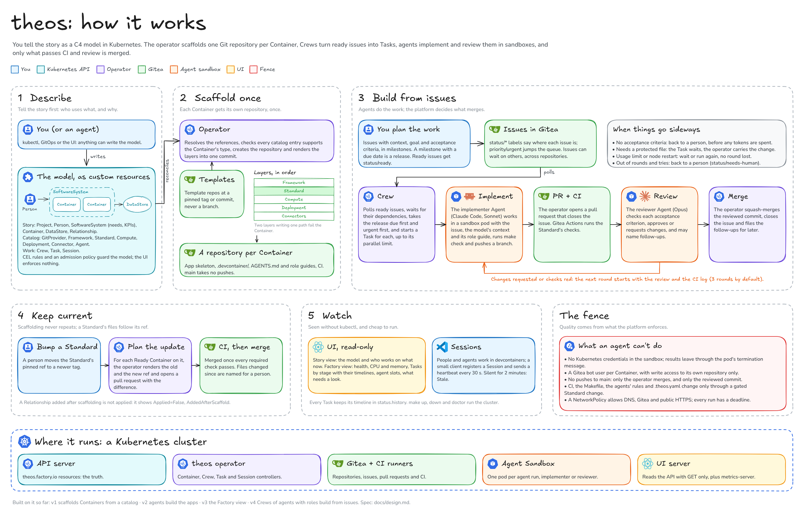

# C4 Factory

**Tell the story first. The factory builds the workspace.**

C4 Factory turns an idea into working, scaffolded repositories. You describe your
software as a small [C4](https://c4model.com)-style model: who uses it, which
systems exist, and which applications and data stores they are made of. A Kubernetes
operator reads that model and creates a ready-to-code repository for every
application.

```
Person ──uses──▶ SoftwareSystem ──contains──▶ Container ──reads/writes──▶ DataStore
                                                  │
                                                  ▼
                               a Git repository, scaffolded once from pinned templates
```

## How it works

[](docs/images/how-it-works.svg)

The board's source is [docs/images/how-it-works.excalidraw](docs/images/how-it-works.excalidraw); open it in Excalidraw to edit it. What runs where, the code layers and where state lives are on the [architecture board](docs/images/architecture.png) in [docs/architecture.md](docs/architecture.md).

1. **The model lives in Kubernetes.** Each element (Project, Person, SoftwareSystem,
   Container, DataStore, Relationship) is a custom resource. Anything can write them:
   kubectl, GitOps, agents or a UI.
2. **Pick from a catalog.** A Container chooses a Framework, Compute and Deployment
   template. A DataStore picks a Connector, such as Postgres.
3. **The operator scaffolds once.** It creates the repository, renders the templates,
   adds a devcontainer, pushes one commit and reports `Ready`. After that it only
   reports.
4. **Work shows up in the model.** Humans and agents code in devcontainers. A small
   client registers each one as a Session, so you can see who is working on what.

Shipping goes through the tool that owns each place an app runs (the GitHub API,
CloudFormation, Argo CD or Flux): the factory hands it each release and shows
the health that tool reports. Monitoring the apps and provisioning real
databases are left to existing tools such as Crossplane.

## Status

The factory runs end to end in a local Kind cluster: the story model, the
catalog, scaffolding into Gitea, Sessions, Tasks and Crews that build from
issues, Standards that keep their Containers current, and a UI with the story,
the work and what needs a person. [docs/design.md](docs/design.md) holds the design,
[docs/results.md](docs/results.md) shows v1 working, with screenshots, and
[docs/results-v3.md](docs/results-v3.md) the factory watching itself.

Devices install the factory from its Helm chart (see
[docs/getting-started.md](docs/getting-started.md)), build their products with
it, and report problems here (see *Report an issue*). The Kind path below is
for developing the factory itself.

[ROADMAP.md](ROADMAP.md) has the release train, the milestones and what 1.0
means.

## Try it

Clone the repository on Linux or WSL and open it in VS Code: `./dev setup` downloads
Go, kubebuilder, Kind, kubectl, Helm, uv and Node into `.dev/`, and Kind runs on
your Docker (Docker Desktop with WSL integration). Run the commands below in the
project shell, which every VS Code terminal opens in; see
[DEVELOPMENT.md](DEVELOPMENT.md).

```sh
make cluster gitea seed   # a Kind cluster with Gitea and the tagged templates
make deploy sample        # the operator, and the webshop story
kubectl get c4 -n webshop # the story as the operator sees it
make session              # a test Session: a pod working on orders-api
make ui ui-forward        # the UI on http://localhost:8080
make e2e                  # all of the above, then check the whole loop
```

A minute after `make sample`, Gitea (`make gitea-forward`, http://localhost:3000)
holds the webshop's repositories, such as `webshop/orders-api`: a uv project with
FastAPI, Kubernetes manifests and a devcontainer with Postgres, pushed as one commit. The repositories are public; to sign
in, `make gitea-admin` prints the admin password, which `make gitea` generates for
each cluster.

To use c4factory on your own cluster instead, install a release: apply Agent
Sandbox, make the project namespaces, then `helm install` the chart with
`gitea.projects`, which brings the operator, the UI and a seeded Gitea with its
CI runners. The chart and images are published to GHCR by a version tag.
[docs/getting-started.md](docs/getting-started.md) takes a device from there to
its first app: the install, the agents' Claude token, a model, an Agent and a
Crew that turn a Gitea issue into a merged pull request.
[The chart's README](dist/chart/README.md) gives the install sequence, its
values and how to pull private images.

## A device without the cluster

The Kind cluster wants about 32 GB of disk. A device with less can still work the
factory's issues with the light setup, `./dev setup --lite`: Go, Node, git, the
GitHub CLI and Claude Code, without Docker, Kind, kubectl or Helm, and with
`C4_CLUSTER=none` set.

- **It can** build and test the operator (`make check`: envtest runs a local API
  server, no cluster), test against a local Gitea (`make test-gitea`), change
  scripts, templates and docs, and run the relay.
- **It can't** deploy, run Crews or `make e2e`. Its relay stops when no issue is
  ready; `hack/relay-watch.sh` starts it again when one is.

No issue needs the cluster: Go tests are the gate, and a Kind cluster runs only
when a human asks for it (`C4_HUMAN_CLUSTER=1 hack/lib/github.sh cluster
acquire`; agents never lease one). So a device without it works every ready
issue.

To set one up:

1. Clone `JairJosafath/c4factory` on Linux or WSL and run `./dev setup --lite` in
   it; the choice is remembered, and VS Code runs `./dev setup` on every open
   after that. Run `gh auth login` and then `gh auth setup-git`: the git
   credential helper gives `hack/lib/github.sh` its token.
2. Open a new terminal (the project shell), run `claude` once to log in, and
   check that `echo $C4_CLUSTER` prints `none`.
3. `hack/relay.sh`, or `hack/relay-watch.sh` to keep it ready for new issues; the
   logs are in `.relay/relay-1.log` and `.relay/watch.log`, `touch .relay/stop`
   stops it.

Opening the folder in VS Code, and `hack/relay-watch.sh` every 30 minutes, trim Go's build cache,
oldest entries first, when it has grown past 4 GB (`hack/trim-go-cache.sh`, `C4_GOCACHE_MAX_GB`),
on every device.

## Report an issue

Report a problem from a device that runs c4factory with the form:
<https://github.com/JairJosafath/c4factory/issues/new?template=user-report.yml>.
Fill in `Reported by` with the device's name (for example `laptop-2`); the issue
gets the labels `source/user` and `user/laptop-2`.

From a terminal, copy this layout into `report.md` and send it with the GitHub CLI:

```markdown
### Reported by

laptop-2

### c4factory version

v0.1.0

### What happened

...

### What you expected

...

### Logs

...
```

```
gh issue create -R JairJosafath/c4factory --title "Crew stalls" --label source/user --body-file report.md
```

## Contributing

Read [AGENTS.md](AGENTS.md) for the project layout and the rules for changing it.
They apply to humans and AI agents alike.
