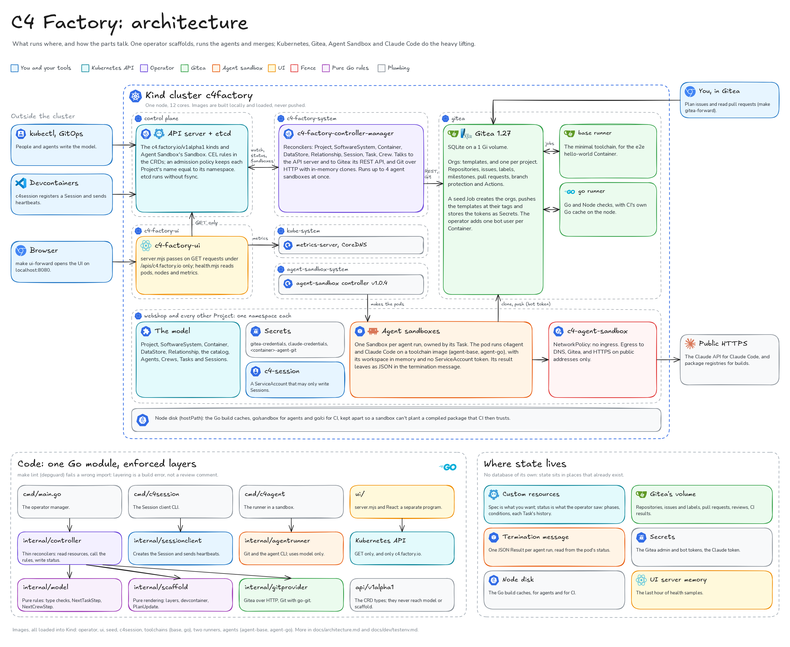

# Architecture

How the code is split, and which way dependencies may point. Read this before adding
code. [design.md](design.md) says *what* C4 Factory does; this file says *where* the
code for it goes.

[](images/architecture.svg)

The board's source is [images/architecture.excalidraw](images/architecture.excalidraw).

## Layers

```
     cmd/main.go            cmd/c4session          cmd/c4agent               ui/ (server.mjs + React)
     (operator manager)     (Session client CLI)   (runner in a sandbox)     (the UI)
          │                       │                      │                        │
          ▼                       ▼                      ▼                        ▼
  internal/controller     internal/sessionclient  internal/agentrunner     Kubernetes API: GETs, Brief writes, actions
                                                  (git + agent CLI; result
                                                   in the termination message)
     │        │        │               │
     │        │        └───────────┐   └──► Kubernetes API (Sessions)
     ▼        ▼                    ▼
internal/  internal/        internal/gitprovider
 model  ◄── scaffold         (Gitea over HTTP, Git with go-git)
(pure rules) (pure rendering)
     ▲        ▲
     └────────┴── api/v1alpha1 types never reach these two

features/ embeds the c4session devcontainer feature; the operator writes it into
every scaffolded repository.
```

| Layer | Packages | May import | Must not import |
| --- | --- | --- | --- |
| API types | `api/v1alpha1` | apimachinery | anything under `internal/` |
| Business rules | `internal/model`, `internal/scaffold` | the standard library, `text/template`, YAML; `scaffold` may use `model` | Kubernetes, controller-runtime, `net/http`, `api/`, other `internal/` layers |
| Adapters | `internal/gitprovider` | `net/http`, go-git, business rules | Kubernetes, controller-runtime, `api/`, `internal/controller` |
| Ports | `internal/ports` and its `fake`, `contract` (the Deployer from #1161; the Git host's from #1094) | the standard library, business rules | Kubernetes, `net/http`, `api/`, adapters, `internal/controller` |
| Adapters | `internal/adapters/*` (`github`, the Deployer, from #1161; the rest from #1094) | ports, business rules; host adapters `net/http` and go-git; runtime and deploy adapters client-go | `api/`, `internal/controller`; host adapters also Kubernetes |
| OCI images | `internal/oci` | the standard library, `net/http`, go-containerregistry; host adapters use it | Kubernetes, controller-runtime, `api/`, any other `internal/` package |
| Sandbox runner | `internal/agentrunner`, `cmd/c4agent` | the standard library, `internal/model` | Kubernetes, controller-runtime, `api/`, `internal/gitprovider`, `internal/controller` |
| Model proxy | `internal/modelproxy`, `cmd/model-proxy` | the standard library; `cmd/model-proxy` also `internal/modelproxy` and `internal/buildinfo` | Kubernetes, controller-runtime, `api/`, `internal/controller`, `internal/gitprovider`; `internal/modelproxy` any other `internal/` package |
| Clients of the API | `internal/controller`, `internal/sessionclient` | everything above but adapters; their tests wire adapters onto fakes | `cmd/`, `internal/adapters/*` |
| Build info | `internal/buildinfo` | nothing | everything; only `cmd/*` reads it |
| Assets | `features` | `internal/scaffold` | everything else |
| Entry points | `cmd/*` | everything | nothing imports them |

The UI in `ui/` is a separate program. Its server proxies GET requests to the
Kubernetes API, under `/apis/c4.factory.io/` only. With its actions off (the
default), it is read-only by construction but for three writes: creating a Brief (`POST` of kind `Brief` into a namespace that
holds a Project; only its name and spec go upstream), appending a follow-up
prompt to one (a JSON patch whose only operation is `add` at `/spec/prompts/-`),
and pausing or resuming one (a JSON patch whose only operation is `add` of a
boolean at `/spec/paused`).
The server refuses every other write, and its RBAC grants only `create` and
`patch` on `briefs` beyond its reads, so what a Brief may say stays the CRD's to
check. With `ui.actions.enabled`, the server's action table (`ACTIONS` in
`ui/server.mjs`, listed in [ui/README.md](../ui/README.md)) takes a few more,
each one method, path, content type and body shape: a Brief's and a Crew's
settings, a release re-run, a Container's scaffold retry, checks and answer to
its Standard's bump, a Task from a goal and a Standard's `ref`. They are made as
the UI's ServiceAccount over port-forward, or as the person signed in with OIDC
behind an Ingress, so the cluster's RBAC decides. It shares nothing with the Go code but the resource shapes. For the Factory and Work areas it also reads pods, nodes and
metrics-server itself (`ui/health.mjs`) and sends the browser only a summary;
pods only in the components' and the Projects' namespaces.

`make lint` enforces the rows marked "must not import" with golangci-lint's
`depguard`, so a wrong import fails the build rather than a review.

## Why the split

- **Business rules stay testable without a cluster.** Checking that a catalog entry
  supports a Container type, rendering template layers, detecting two layers writing
  the same path and assembling `devcontainer.json` are plain functions over plain Go
  values. Their tests are table tests that run in milliseconds.
- **Controllers stay thin.** A reconciler reads resources, turns them into plain
  values, calls the business rules and adapters, and writes status. If a controller
  grows an `if` about templates or types, that logic belongs in `internal/model` or
  `internal/scaffold`.
- **The Git host sits behind an interface, but only Gitea is proven.** The
  controllers use `gitprovider.Provider`, whose shape is Gitea's. The ports a
  second host plugs into, and the rule for calling one swappable, are in
  [Ports](#ports).

## Ports

The factory's swappable parts, decided in
[design.md](design.md#factory-components-ports-and-adapters). A new port or
adapter changes its row here in the same pull request; the maintainer reviews
it against this table. Where the code lives:

- **Ports** are in `internal/ports`, one file per port with its interface and
  shared types, and may import only the standard library, `internal/model`
  and `internal/scaffold`. Their fakes are in `internal/ports/fake`, their
  contract suites in `internal/ports/contract` (`contract.GitHost(t, env)`
  and so on), which each adapter's tests call.
- **Adapters** are in `internal/adapters/<implementation>`, one package each:
  `gitea` implements GitHost, Issues, CI, AgentAccess and Registry,
  `agentsandbox` implements AgentRuntime, and `github`, `gitlab`, `argocd`
  follow. Plain Git over HTTPS (go-git: template fetches and pushes) is
  shared in `internal/adapters/git`. A host adapter imports no Kubernetes;
  the runtime and deploy adapters may use client-go, never `api/` or
  `internal/controller`.
- **Controllers take ports.** Only `cmd/main.go` imports adapters: it builds
  the adapters a GitProvider names and gives each reconciler the ports it
  calls. A depguard rule denies `internal/adapters` in `internal/controller`
  outside its tests, which wire adapters onto the fakes; #1094 adds
  `internal/gitprovider` to it.
- **A host's events reach the controllers through the operator's receiver**
  (`internal/controller/git_events.go`, from #1084): the adapter checks a
  delivery's signature and says what it concerns, the receiver finds the
  GitProvider and its Secret, which needs Kubernetes, and each controller
  maps the delivery to its own objects.
- **The per-CI table** (`model.CI`: its name, which names the templates'
  `.c4factory/ci/<name>/` folder, check contexts, protected paths) is in
  `internal/model`, so `internal/scaffold` reads it without an adapter.
- **The host-neutral guard** is a Go test beside the ports
  (`internal/ports/hostneutral_test.go`, from #1094) with its allowlist of
  today's `gitea` and `.gitea/` hits, file and count, which may only shrink.

`internal/ports` holds the Deployer (#1161). Until #1094 lands,
`internal/gitprovider` holds all of the Git host's ports as one interface,
`Provider`, and the controllers' fake is `internal/controller/fakegit_test.go`;
the column *Today* says where each port is now.

| Port | Interface | Picked by | Implementations | Contract test | Credential path | Today |
| --- | --- | --- | --- | --- | --- | --- |
| GitHost | repositories, files, pushes, branches, tags, branch rules, pull requests, merges (with bypass), commit statuses, source at a tag; optional: Events, a hook on the owner and signed deliveries (#1084, [plans/git-events.md](plans/git-events.md)) | `GitProvider.spec.provider` | Gitea | to write (#1094): fake in `make test`, Gitea in `make test-gitea` | GitProvider Secret, operator only; Events: the delivery Secret the operator makes | `gitprovider.Provider` |
| Issues | issues, comments, labels (exclusive by scope), assignment, milestones, dependencies; intake uses list, comment, find comment, close, membership | `GitProvider.spec.provider`; intake by the Brief's `releases[].requests` | Gitea; GitHub for intake only | to write (#1094) | GitProvider Secret; intake by the Brief's token Secret; operator only | `Provider` and `IssueTracker` |
| CI | runs of a commit or tag, rerun failed jobs, a job's log, runners online (may be unknown); the per-CI table in `internal/model`; optional: OwnerRunners, the owner organization's runner registration token, its runners and their state, deleting one (#1139, [plans/ci-runner-isolation.md](plans/ci-runner-isolation.md)) | the host's own, else `GitProvider.spec.ci.<member>` | Gitea Actions | to write (#1094); OwnerRunners: Gitea in `make test-gitea`, its fake beside the controllers' | jobs: none of the user's, the host's job token scoped to the repository; the operator reads runs, and an owner's runner registration token, with the GitProvider Secret | `Provider`; `OwnerRunners` (`internal/gitprovider/runners.go`); the per-CI table `model.CI` (`internal/model/ci.go`) |
| AgentAccess | mint a credential that writes to one repository, with its expiry; revoke old ones; remove | `GitProvider.spec.provider` | Gitea (a bot user per Container or Brief) | to write (#1094): writes its repository, not another, cannot merge to `main`, revoked means refused | minted from the GitProvider Secret into the Container's agent Git Secret, passed to its sandboxes | `Provider` |
| Registry | Go modules (optional), Go proxy address, a release's image archive pushed by digest (#1069, [plan](plans/images.md)) | the host's own, else `GitProvider.spec.registry.<member>` | Gitea packages | to write (#1094) | GitProvider Secret for the operator; CI only attaches release files with its job token | `Provider`, `Repository.GoProxy` |
| AgentRuntime | start a run, its state and result, stop it, list held runs; the fence is the adapter's | Helm installs one; no field until a second | Agent Sandbox | to write; the sandbox's pod spec and fence tests in `make test` | operator ServiceAccount; the sandbox gets no Kubernetes token | `SandboxGVK`, `buildSandbox`, `runState` in `internal/controller` |
| Deployer | check a target's credential, ship a built release to it (one write per call where the adapter is the tool, as for GitHub releases), read its state back; a Deployment template writes the tool's files | the `DeployTarget`'s member, by a map from member name to adapter in `cmd/main.go` (`github`; `argoCD` #1072 ([plans/k8s-deploy.md](plans/k8s-deploy.md)), `cloudFormation` #1071, `flux` later); the member requirement table is `model.DeployMember` (`internal/model/deploy.go`) | GitHub releases (`internal/adapters/github`), which the Crew's `publishReleases` copy calls too; Argo CD (`internal/adapters/argocd`, #1586): one `Application` per Container by server-side apply, wired to the `argoCD` member (#1588) | `contract.Deployer(t, env)` ([plans/done/deploy.md](plans/done/deploy.md)): the fake (`internal/ports/fake`), the GitHub adapter on the publish tests' fake GitHub, and the Argo CD adapter on envtest with Argo CD's CRDs (`test/crds/argocd`) and a fake Argo CD that syncs each Application, in `make test`; the state rule is `model.ArgoCDDeployState`, table-tested | the DeployTarget's `credentialsSecretRef` (and `publishReleases.github.tokenSecretRef` until #1598, step 2 of [plans/github-deploy.md](plans/github-deploy.md)), operator only; CI never holds it | `ports.Deployer` (`internal/ports/deployer.go`); the GitHub adapter calls `ReleaseTarget` in `internal/gitprovider/github.go` until #1598, step 2 of [plans/github-deploy.md](plans/github-deploy.md) |

No port is swappable yet: none has two real adapters passing a full contract (Issues on GitHub covers intake only). A port is called
swappable here once its fake and two real adapters pass its contract.

## Flow of one scaffold

1. `internal/controller` resolves the Container's references and converts the
   resources into `model` values.
2. `internal/model` checks every catalog entry supports the Container type.
3. `internal/gitprovider` creates the repository and fetches each template at its
   pinned ref.
4. `internal/scaffold` renders the layers in order (Framework, Compute, Deployment,
   Connectors), fails on a path owned by two layers, adds `.devcontainer/` and
   `.c4factory.yaml`, and returns one file tree.
5. `internal/gitprovider` pushes that tree as a single commit.
6. `internal/controller` writes `Ready`, `repositoryURL`, `scaffoldedFrom` and
   `appliedRelationships` with `appliedConnectors` (what each Relationship added).

## Flow of a Standard update

A Ready Container with a Standard follows its Standard's `spec.template.ref`, one
step per reconcile (`internal/controller/container_standard.go`); the minute
recheck polls the pull request, and a Standard's spec change enqueues its
Containers at once.

1. `internal/controller` takes the ref the Container's Standard files are at from
   `status.standard`, or before the first update from `scaffoldedFrom`
   (`model.ScaffoldedRef`). It compares it with the Standard's ref.
2. `internal/gitprovider` fetches the template at both refs; `internal/scaffold`
   renders each with the scaffold's input (`RenderLayer`); `gitprovider` reads
   `main`'s copy of every path either render has (`ReadFiles`).
3. `internal/scaffold.PlanUpdate` decides by whole files what to write, remove
   and leave out. Nothing to write: the controller records the new ref.
4. `internal/gitprovider` pushes one commit onto the `main` commit it read
   (`PushBranch`, branch `model.StandardUpdateBranch`) and opens a pull request
   with `model`'s title and body. The controller records it in
   `status.standard.update`.
5. Each later reconcile reads the pull request: merged, closed, conflicting,
   pushed to by someone else, or waiting for CI. `model.NextStandardStep`
   decides every step from the facts the controller reads, one read at a time:
   whether to plan, record a merge, drop, stop, wait or merge. Once CI is green,
   `model.StandardUpdateRefusal` checks the required checks and the paths, and
   `gitprovider` merges it as admin (`ForceMergePullRequest`). The controller
   moves `status.standard.ref` and reports each step in the condition
   `StandardUpdated`.

## Flow of one Session

1. The c4session feature installs the client in the devcontainer and runs
   `c4session start` after every start.
2. `internal/sessionclient` finds `.c4factory.yaml`, creates a Session on that
   Container and patches its status with a heartbeat every 30 seconds.
3. `internal/controller` adopts the Session under its Container, counts it in
   `activeSessions`, and marks it `Stale` two minutes after the last heartbeat.
4. On SIGTERM the client deletes its Session.

Each step is safe to repeat: see "Two rules keep this safe to retry" in
[design.md](design.md#scaffolding-a-container).

## Flow of one Task

1. `internal/controller` reads the Task live (not from the cache: steps have side
   effects), adopts it under its Container, and gathers the facts: is the
   Container Ready, is an earlier Task still active on it, what did the current
   sandbox report, what do the checks say, and whether an unavailable agent's
   wait (`status.agentBackAt`) is over.
2. `internal/model.NextTaskStep` turns the facts into one step: wait, start the
   implementer or reviewer, open the pull request, merge, next round, wait for an
   unavailable agent, or fail. The model also decides what each step does to the
   Task (`internal/model/task_transition.go`): the controller copies the status
   into a `TaskProgress`, applies one transition and copies it back.
   `StartRun`, `OpenedPR`, `NextRound`, `ResolveConflicts`, `UpdatedBranch`,
   `RetryReview`, `Rerun`, `Recheck` and `Proposed` move the round, phase and feedback;
   `DecideMerge` and `AfterSquash` choose what to do with an approved pull
   request; `AgentBackAt` sets an unavailable agent's wait; and `IssueClosed`,
   `PullRequestClosed` and `GatedMergeRefused` end the Task.
3. To start a run, the controller makes sure the Container's agent bot user exists
   (`gitprovider.EnsureAgentAccess`, token in Secret `<container>-agent-git`) and
   creates an Agent Sandbox `Sandbox` owned by the Task, with the role's Agent
   (`spec.agentRef` implements, `spec.reviewerRef` reviews) and its harness and
   model. Its pod mounts no ServiceAccount token; the project's NetworkPolicy lets
   it reach only DNS, the Git host and public HTTPS. A Task with `spec.issue`
   reads the issue before every run and passes it as the goal; on its first run
   it labels the issue `status/in-progress`, assigns the bot and comments.
   `c4Context` gives the agent the Container's place in the story: the system's
   needs and KPIs, its users, each Relationship, and the related Containers'
   repositories.
4. In the pod, `cmd/c4agent` reads its job from the environment, and
   `internal/agentrunner` clones with the bot's token, clones the related
   repositories read-only, reads the role guide (`docs/agents/<role>.md`) from the
   base branch, runs the agent, runs `make check` and sends the agent back while
   it fails, pushes the branch, and writes one JSON `Result` to the termination
   message. A reviewer run answers with a JSON verdict and up to three follow-ups,
   each with up to three acceptance criteria, instead. A usage limit, an overload, a 5xx server error or rejected credentials come back as
   `unavailable`: the Task keeps its round and tries again later.
5. The controller reads the result from the pod status, opens the pull request as
   the agent bot (Gitea refuses a review of one's own pull request), polls the
   combined commit status until CI is done, runs the reviewer, posts its verdict
   as a pull request review, and squash-merges on approval. For an issue it then
   comments, files the follow-ups as `status/proposed` issues in the Later
   milestone, outside any release, and closes it; a failed Task hands the issue
   back with `status/needs-human`. Status is patched
   with an optimistic lock, so a stale write is retried rather than repeating a
   step. Notes on the Git host (labels, comments, reviews) are logged when they
   fail; they never decide a step.
6. **A Standard change.** After a round the runner splits the agent's commits:
   edits to eligible protected paths (the Makefile, `.gitea/`, lint config,
   `docs/style/`, `.devcontainer/`; never `AGENTS.md`, `docs/agents/` or
   `.c4factory.yaml`) go to a proposal branch `standard/<task>` and are reverted
   on the Task branch; an ineligible path fails the round. The result carries the
   proposal (branch, paths, reason).
7. **`Blocked`.** The controller files a `kind/standard-change` issue as the
   operator (with an acceptance checklist, the paths and the branch), makes it
   block the Task's issue in Gitea, records `status.standardChange` and sets the
   phase `Blocked`. A `Blocked` Task runs no agent and spends no round. A third
   Standard change fails the Task ("more than two"), and so does a proposal from
   a Task with a goal or one no Crew started: only a Crew runs the change.
8. **Resume.** When a Task on the change's issue has reached `Merged`, the
   `Blocked` Task goes back to `Implementing` in the same round, and the runner
   merges `main` in. If the change closed unmerged or failed, the Task fails with
   that reason. If the branch then equals `main`, the Task ends `Merged` with
   reason `DoneByStandardChange` and the operator closes the issue. Once the
   change merged or will not, the operator deletes the proposal branch.
9. **Gated merge.** The Crew gives the change's Task `spec.allowedProtectedPaths`,
   copied from the waiting Task's status; a label alone grants nothing. The
   runner allows exactly those paths. Gitea's protected-file rule blocks the
   normal merge, so the operator checks CI, the approval and every changed path
   (a rename's old path too) itself, then merges with Gitea's admin
   `force_merge`. CI passes only if each required `check*` pattern has a
   matching context that succeeded and every other match succeeded too or was
   skipped (a push run off main), as branch protection requires, so a renamed
   workflow or job is refused. CI still pending: it
   waits while the review run that approved it lasts. When that run ends first,
   on the reviewed commit or on the branch with `main` merged in, the change
   goes back to `Checking` in the same round (reason `ApprovalEnded`), no try
   spent, and is reviewed again once CI passes, so no reviewer run is spent on
   a CI wait and nothing merges without a lasting approval. A pull request too large to list (1000+
   files) is refused too. A gated change may touch only its allowed paths, so
   neither its implementer nor its reviewer is asked for tests; the check
   command passing and the reviewer's three checks decide. The gated
   implementer's prompt overrides old guides:
   Containers on Standard v1.0.0 have guides that say "stop", and a Standard
   may ship none and an `AGENTS.md` that says "Leave .devcontainer/,
   .c4factory.yaml and .gitea/ alone"; the prompt says to follow it instead. Only
   `go-standard` and `ts-standard` (v1.1.0 and later) and `python-standard` ship guides
   that describe Standard changes.

## Go modules of the factory's apps

An app's Go module path is `c4factory.local/<project>/<container>` (the Go
templates' `go.mod`), which no public proxy knows. Agent sandboxes of a
Container's Tasks get `C4_GO_REGISTRY=<gitea>/api/packages/<owner>/go`,
`GOPROXY=http://127.0.0.1:3127,direct` and `GONOSUMDB=c4factory.local`
(`buildSandbox`, from the GitProvider's URL and owner through
`gitprovider.Repository.GoProxy`). c4agent serves `agentrunner.GoProxy` there
while the agent works: `c4factory.local/` paths go to the registry and nowhere
else, with the bot's credentials over https (`gitprovider.AgentTokenScopes`
lets it read the owner's packages; the token's name carries its scopes, so an
operator upgrade that changes them makes a new token beside the old one
instead of revoking what a running sandbox of the Container holds. The agent
Git Secret's `c4.factory.io/old-tokens-before` annotation records when; at
the start and end of each run, once every sandbox of the Container started
after it (`model.OldTokensUnused`), the operator revokes the old tokens
(`gitprovider.RevokeOldAgentTokens`) and drops the annotation), and every
other path to
proxy.golang.org. The go command has no per-path proxy, and with a list of
the registry, then the public proxy, it would ask the public proxy for a
factory module the registry lacks (it goes on after a 404), leaking the
project's and Container's names. go-standard's CI (v1.1.5) downloads the
`c4factory.local/` modules of `go.sum` with `GOPROXY` set to the registry
alone, then runs `make check` with `GOPRIVATE=c4factory.local`, so no proxy is
asked for them. [plans/done/app-modules.md](plans/done/app-modules.md) has why.

## Go build caches

A Go Task runs `make check` three or four times a round: the agent while it
works, `internal/agentrunner` after it, CI on the `go` runner and the reviewer.
Two caches on the Kind node's disk keep compiled packages between pods, so
each run compiles only what changed:

| Cache | Node directory | Mounted by | Set up by |
| --- | --- | --- | --- |
| sandboxes | `/var/cache/c4factory/go/sandbox`, the operator's `--sandbox-go-cache` | every agent sandbox, at `/cache/go`, with `GOCACHE` and `GOLANGCI_LINT_CACHE` pointing into it | an init container in the agent's image |
| CI | `/var/cache/c4factory/go/ci` | only the `go` runner (`config/runner/go.yaml`); jobs get the variables from the runner's `env_file` | an init container, and a sidecar hourly |

- **CI's cache is its own.** Go doesn't check what it reads from a cache, so a
  sandbox that could write CI's cache could plant a compiled package that CI,
  the gate, then trusts. No sandbox mounts it. The sandbox cache is shared by
  all projects: a sandbox's checks are not the gate.
- **`c4-go-cache DIR`** (`hack/toolchain-go/go-cache.sh`, in the toolchain-go
  image) seeds an empty cache from the image's warm one (the Kubernetes CEL
  libraries, about 3 GB) and keeps it under 8 GB: it drops entries unused for a
  day, then all of them, and seeds again. It deletes entry files only, under a
  lock, so a build running at the same time sees a miss, not an error. An agent
  image without Go has no `c4-go-cache`, and its init container exits at once.
- hostPath, not a PVC: one node, one directory per cache, and no project
  namespace enforces Pod Security. Remove the flag, or the runner's volume, to
  go back to cold builds.

## Flow of one Crew

1. Every minute, and when a Task on its Container changes phase or the Container
   turns Ready, `internal/controller` reads the Crew, adopts it under its
   Container, checks its Agents exist, and lists the Container's Tasks live.
2. Through `gitprovider` it makes sure the status labels exist, lists the open
   issues labelled `status/ready`, and reads each one's open dependencies.
3. `internal/model.NextCrewStep` decides: issues without an acceptance criteria
   checklist, already merged, or tried three times go back to a person; issues
   with open dependencies wait; up to `parallel` Tasks work on the Container at
   once, and `Blocked` Tasks don't count, so a Crew can't fill its slots with
   Tasks that wait; otherwise the lowest-numbered ready issues get a Task
   `<container>-<issue>` (with `-<attempt>` from the second try), with the Crew's
   implementer and reviewer. For a `kind/standard-change` issue it sets the
   Task's `spec.allowedProtectedPaths` from the filing Task's
   `status.standardChange`, leaving out any ineligible path; such an issue
   starts before the other ready issues, so the `Blocked` Task's branch doesn't
   age behind the backlog.
4. The controller labels the handed-back issues `status/needs-human` with the
   reason, creates the Task, and writes the Crew's phase, active Task and its
   ready and waiting issues.

The operator never branches on a Container type: `internal/controller/typeneutral_test.go`
fails when controller, scaffold or runner code names one. Everything type-specific
lives in the catalog's templates.

## Flow of the factory's health

1. Every 15 seconds, and when a browser asks for `GET /factory/health`,
   `ui/health.mjs` lists the pods, the nodes and their metrics, timing the node
   list as the API server's response time. Answers are cached for 5 seconds.
2. It matches pods to the factory's components by namespace and labels
   (`DEFAULT_COMPONENTS`, overridable with `FACTORY_COMPONENTS`), finds the agent
   sandboxes by their label, and reads the operator's `--max-agent-sandboxes`.
3. It returns states, restarts, usage and the last hour of samples, never a pod
   spec.
4. The browser combines that with the Tasks, Agents, Containers, Sessions,
   Crews and Briefs it watches (`src/model/factory.ts`): the board, each Task's timeline
   from `status.history`, the Crews, the time per stage and the "Needs a look"
   list, each item naming the Brief whose `status.attention` or `needsYou`
   lists it.

The Task controller writes `status.history` in `writeStatus`, through
`model.RecordTransition`.
