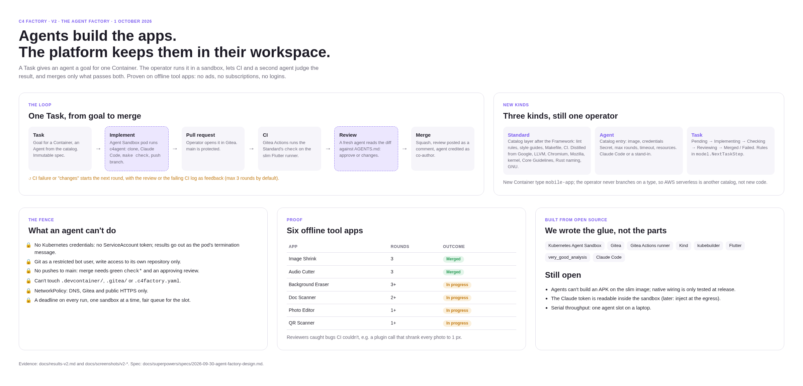

# C4 Factory: Design and MVP v1 Plan

Sep 30, 2026 · @Jeremy Jo.


## Purpose

C4 Factory turns an idea into a working, scaffolded repository by first telling its story as a C4-inspired model. The model lives in Kubernetes custom resources, a kubebuilder operator acts on it, and a UI draws the story on top.

- **Storytelling first.** The model shows who uses what, what exists and why, and who is working on it right now.
- **The CRDs are the truth.** Anything can write them: kubectl, GitOps, agents or the UI. The UI enforces nothing; the rules live in the CRD schemas and the operator.
- **A thin factory.** Open-source tools do the real work: uv for Python, each framework's own tooling, ArgoCD or Flux for shipping. The factory scaffolds and reports.
- **Humans and agents are equal.** Both work in devcontainers, and both show up in the model as Sessions.

## Decisions so far

These were settled in the design discussion on 30 September 2026 and shape everything below.

| Topic | Decision |
| --- | --- |
| Source of truth | The custom resources in the cluster. The UI is one client among several. |
| Project scope | One Project per namespace. No references across namespaces; reuse is by copying. |
| Levels | Person, SoftwareSystem, Container and DataStore. Component and Code are dropped for now. |
| Container | An application with its own repository. One repository per Container, no monorepos. |
| Container type | A fixed list: `static-site`, `service`, `job`, `worker`. |
| Catalog | One entry per side of a Container (Framework, Compute, Deployment, Connector), kept per namespace. Bundles can come later, as a team choice. |
| Compatibility | Each catalog entry lists the Container types it supports. The operator checks this before scaffolding; no webhook in v1. |
| Templates | Catalog entries point to platform-managed template repositories at a pinned tag or commit. |
| Repositories | New work only. The operator creates each repository; adopting existing ones is out of scope. |
| Git provider | Its own kind, `GitProvider`, per namespace. Every Container references one. |
| Scaffolding | Once, at creation. Staying compliant afterwards is the Container owner's job. Status records the template versions used. |
| Data stores | Their own kind, `DataStore`, backed by a Connector. A Relationship from a Container to a DataStore adds that Connector to the Container's scaffold. |
| Shipping | Outside the operator. Deployment templates produce standard files that existing tools pick up. |
| Sessions | Devcontainers run anywhere. A small client inside registers a Session on its Container and reports minimal status. |
| Status | v1 shows only the factory's own steps plus active Sessions. Runtime health comes later. |

## The model

Sixteen namespaced kinds in `c4.factory.io/v1alpha1`: six tell the story, three track work (Session, Task since v2, and Crew since v4), and seven configure the factory. Every child names its parent in `spec`; the operator turns that into the ownerReference, so deletion follows the tree.

&#91;embedded content: ownership tree · 9 boxes, 1 relationship\]

Solid arrows mean "owns": deleting a parent deletes its children. The dashed Relationship is the only link that changes a scaffold. Containers also reference a GitProvider and catalog entries, which isn't drawn here.

| Kind | Owned by | Parent field | What it is |
| --- | --- | --- | --- |
| Project | nothing | none; name equals the namespace | The whole story, one per namespace |
| Person | Project | none | A user, role or stakeholder |
| SoftwareSystem | Project | none | A system that delivers value, with its needs and KPIs |
| Container | SoftwareSystem | `spec.softwareSystemRef` | An application with its own repository |
| DataStore | SoftwareSystem | `spec.softwareSystemRef` | A database or storage, backed by a Connector |
| Relationship | its source element | `spec.source` | A directed link between two elements |
| Session | Container | `spec.containerRef` | An agent or human at work in a devcontainer |
| GitProvider | Project | none | Where repositories are created, with credentials |
| Framework, Compute, Deployment, Connector | Project | none | Catalog entries: a pinned template plus the Container types it supports |
| Standard (v2) | Project | none | Catalog entry: coding rules, checks and CI, rendered right after the Framework it fits |
| Agent (v2) | Project | none | Who does Tasks: an image with the agent CLI and toolchain, credentials and limits |
| Task (v2) | Container | `spec.containerRef` | A goal for a Container, implemented, checked, reviewed and merged by agents |
| Crew (v4) | Container | `spec.containerRef` | The Agents that implement and review a Container's issues, and pick up the ready ones |

The story kinds, abbreviated:

```yaml
kind: SoftwareSystem
metadata: {name: webshop-core, namespace: webshop}
spec:
  displayName: Webshop Core
  description: Catalog, cart and ordering
  needs: [Customers can reorder in two clicks]
  kpis: [Checkout conversion]
---
kind: Container
metadata: {name: orders-api, namespace: webshop}
spec:
  softwareSystemRef: {name: webshop-core}
  displayName: Orders API
  type: service
  gitProviderRef: {name: gitea}
  frameworkRef: {name: python-fastapi}
  computeRef: {name: small}
  deploymentRef: {name: k8s-manifests}
status:
  phase: Ready
  repositoryURL: http://gitea.gitea.svc.cluster.local:3000/webshop/orders-api
  scaffoldedFrom: [python-fastapi@v1.2.1, small@v1.0.0, k8s-manifests@v1.1.0, postgres@v1.1.0]
  activeSessions: 1
---
kind: DataStore
metadata: {name: orders-db, namespace: webshop}
spec:
  softwareSystemRef: {name: webshop-core}
  displayName: Orders DB
  connectorRef: {name: postgres}
---
kind: Relationship
metadata: {name: orders-api-to-orders-db, namespace: webshop}
spec:
  source: {kind: Container, name: orders-api}
  target: {kind: DataStore, name: orders-db}
  description: Reads and writes orders
```

The factory kinds, abbreviated:

```yaml
kind: GitProvider
metadata: {name: gitea, namespace: webshop}
spec:
  provider: gitea                  # the only value in v1
  url: http://gitea.gitea.svc.cluster.local:3000
  owner: webshop                   # organization for Container repositories
  credentialsSecretRef: {name: gitea-credentials}
---
kind: Framework                    # Compute, Deployment and Connector look the same
metadata: {name: python-fastapi, namespace: webshop}
spec:
  displayName: Python, FastAPI (uv)
  supportedTypes: [service]
  template:
    url: http://gitea.gitea.svc.cluster.local:3000/templates/python-fastapi
    ref: v1.2.0                    # tag or commit, never a branch
---
kind: Session
metadata: {name: orders-api-k7f3q, namespace: webshop}
spec:
  containerRef: {name: orders-api}
  actor: agent                     # or human
  summary: Adding order validation
status:                            # written by the client; the operator only marks it Stale
  phase: Active
  lastHeartbeat: "2026-09-30T09:12:00Z"
  openInEditor: ""                 # set only when the devcontainer is reachable
```

Fields stay minimal on purpose. Metadata such as `displayName` and `description` is on every story kind; `metadata.name` is the stable id and can't change.

## How it works

A Container is scaffolded exactly once, from the catalog entries it picks and the DataStores it points to. After that, the factory only reports.

### Scaffolding a Container

1. **Resolve references.** The SoftwareSystem, GitProvider and catalog entries must exist. Until they do, the Container stays `Pending` with the missing name in its condition.
2. **Check types.** Every catalog entry used, including the Connectors reached through Relationships, must list the Container's type. If not, the Container is `Failed` with `ChoicesValid=False`, for example "python-fastapi does not support static-site".
3. **Create the repository** in the GitProvider's organization, named after the Container.
4. **Render the layers** in a fixed order: Framework, Compute, Deployment, then each Connector. Templates are Go `text/template` files that receive the project, system, container and type names, the names of the chosen Framework, Compute and Deployment (empty when the Container picks none), plus the list of Connectors.
5. **Assemble the devcontainer.** The operator writes `.devcontainer/devcontainer.json` itself: the Framework's base settings plus one compose file per Connector, such as a Postgres service for local development and tests.
6. **Write the identity file** `.c4factory.yaml` with the project and container names.
7. **Push one initial commit,** then set `Ready`, `repositoryURL` and `scaffoldedFrom`.

Two rules keep this safe to retry. Every file belongs to exactly one layer, so two layers writing the same path fail the Container with that path in the message. And if the repository exists but is empty, the operator retries the commit; if it has commits the operator didn't make, it stops with `Failed`. A `Failed` Container tries again when something it depends on changes (its spec, a catalog entry, the GitProvider, a DataStore or a Relationship), or when someone sets or changes its `c4.factory.io/retry` annotation, for example after emptying the repository.

### Relationships

- **Container to DataStore:** applies that DataStore's Connector at scaffold time.
- **Everything else** (Person to SoftwareSystem, Container to Container): story only in v1.
- **Added after scaffolding:** not applied, by design. The Relationship shows `Applied=False` with reason `AddedAfterScaffold`, so the gap is visible. That includes a Relationship deleted and recreated under the same name with another target: the Container records which DataStore and Connector each applied Relationship added.
- **Fixed ends:** a Relationship's source and target, and a DataStore's Connector, can't change, so `Applied` keeps meaning what the scaffold holds. To point a link elsewhere, create a new Relationship.

### Sessions

1. A devcontainer feature installs the client, a small Go CLI.
2. On start, the client reads `.c4factory.yaml` and creates a Session on its Container, with the actor (agent or human) and a one-line summary of the work.
3. It sends a heartbeat every 30 seconds and deletes the Session when the devcontainer stops.
4. The operator marks a Session `Stale` after 2 minutes without a heartbeat and counts the Active ones on the Container.

In v1, the client authenticates with a per-namespace ServiceAccount that may only create, update and delete Sessions.

### Status

- **Container phase:** `Pending`, `Scaffolding`, then `Ready` or `Failed`, with conditions `ReferencesResolved`, `ChoicesValid`, `RepositoryCreated` and `Scaffolded`.
- **Roll-up:** SoftwareSystem and Project show counts, such as "3 of 4 containers Ready, 2 active sessions".
- **kubectl:** printer columns (Type, Phase, Sessions, Age) make `kubectl get containers` a quick text view.

## v2: agents build the apps



Settled step by step on 30 September 2026; the full design is
[superpowers/specs/2026-09-30-agent-factory-design.md](superpowers/specs/2026-09-30-agent-factory-design.md)
and the plan [plans/agent-factory.md](plans/agent-factory.md).

Agents build complete apps when asked, and stay inside their workspace while they
do. Quality does not come from trusting the agent but from what the platform
enforces.

- **A new Container type, `mobile-app`.** The operator never branches on a type;
  a test keeps it that way. A later `function` type (AWS serverless) is one enum
  value plus templates.
- **Standard: the rules as a layer.** Lint and format config, `AGENTS.md`, offline
  style digests, the `make check` contract and its CI workflow, rendered right after
  the Framework it lists. A Container with a Standard gets `main` protected by
  required checks at scaffold time, and `status.checks` reports CI on `main`.
- **CI in Gitea.** Gitea Actions with a runner in the cluster on the same toolchain
  image the agents and devcontainers use.
- **Task: a goal for a Container.** The operator runs the Agent in an
  [Agent Sandbox](https://github.com/kubernetes-sigs/agent-sandbox), which works on
  branch `task/<name>`; opens a pull request; waits for CI; runs the Agent again as
  reviewer; and squash-merges on approval. Failed checks, requested changes or a
  failed run start the next round with that feedback, up to the Agent's
  `maxRounds`. The Container's Crew decides how many Tasks run at once.
- **The fence.** The sandbox pod has no ServiceAccount token and reports through
  its termination message; a per-Container Gitea bot user can write to that one
  repository only; `main` takes no pushes, only the operator merges (the reviewed
  commit only), and the Git host refuses changes to the platform's and the
  Standard's protected files (only the operator's gated merge of a Standard change
  passes, after its own checks) and keeps `v*` tags to the operator; a per-project
  NetworkPolicy allows only DNS, the Git host and public HTTPS; each run has a
  deadline. The Claude token is readable inside the sandbox; Agent Substrate's
  egress credential injection is the later fix.
- **App values are needs, not platform rules.** "Works offline, no login, no ads"
  is a need on the Pocket Tools SoftwareSystem in `config/samples/toolbox`; the
  agents get the needs with every Task.

## v3: watching the factory

Settled on 1 October 2026; the plan is
[plans/factory-monitoring.md](plans/factory-monitoring.md) and what it found is in
[results-v3.md](results-v3.md).

The factory runs whole Task loops on its own, so it needs to be seen and run
without kubectl, and cheaply: it lives on a laptop.

- **A Task keeps its timeline.** `status.history` gets an entry whenever the
  phase, round or Progressing reason changes (the newest 64), so where a Task's
  time went stays readable after it ends. A Task waiting for an agent slot says
  `WaitingForSlot`.
- **The UI has a Factory view** next to the story, across all projects: component
  health with CPU and memory, the last hour, the Tasks on a board by stage with
  their timelines, where the time goes, agent slots, and what needs a look.
- **The UI server reads the factory's health itself** (`GET /factory/health`):
  pods, nodes and metrics-server, summarized; pod specs never reach the browser,
  which still reads only `c4.factory.io`. It samples every 15 seconds and keeps
  an hour in memory, including its own API round trip.
- **No Prometheus or Grafana.** Process data lives in the resources, live usage
  comes from metrics-server (about 30 MiB), and the last hour from the UI server.
- **Lifecycle targets:** `make down` stops the Kind node, `make up` brings it back
  and gets pods out of back-off, `make doctor` checks every part.
- **Checks work in memory.** CI jobs and, with `--sandbox-workspace-memory`,
  agent sandboxes write their builds to memory-backed volumes: on the disk, they
  stalled etcd and with it the whole control plane.

## v4: issues, crews and roles

Decided on 2 October 2026 while building CEL Lens; the full design is
[superpowers/specs/2026-10-02-issue-driven-factory-design.md](superpowers/specs/2026-10-02-issue-driven-factory-design.md),
the plan [plans/issue-driven-factory.md](plans/issue-driven-factory.md), and what
the run found [results-v4.md](results-v4.md).

v2's apps were built one Task per app, and their quality was only "ok for
testing". v4 makes the work smaller and clearer, and gives each role the agent,
model and context it needs.

- **Issues are the work.** A Task can take its goal from an issue of its
  Container's repository (`spec.issue`). The operator reads it before every run,
  labels it `status/in-progress`, comments who works on it, opens a pull request
  that closes it, and closes it on merge; a failed Task hands it back with
  `status/needs-human` and the reason. The `status/*` labels are exclusive, so an
  issue is in one state at a time.
- **Ready means clear.** An issue needs an "Acceptance criteria" checklist before
  an agent gets it; without one it goes back to a person before any tokens are
  spent. The Standards' issue templates ask for context, goal, criteria, scope and
  notes.
- **A Crew per Container picks up the work.** It names the implementer and the
  reviewer Agents, polls the repository's `status/ready` issues, waits for their
  Gitea dependencies (also across repositories) to close, and starts up to `parallel`
  Tasks at a time (one by default; a `Blocked` Task doesn't count), lowest number
  first, up to three tries per issue. Milestones group the
  backlog; Gitea 1.27 has no API for project boards.
- **Roles get their own model and guide.** Agents have a `harness` and a `model`;
  CEL Lens pairs a Sonnet implementer with an Opus reviewer. A Standard ships
  `docs/agents/implementer.md` and `reviewer.md`, read from the base branch so a
  change can't rewrite its own review. The reviewer reports each acceptance
  criterion, posts its verdict as a pull request review, and may name up to three
  follow-ups, which become `status/proposed` issues in the Later milestone,
  outside any release.
- **Context comes from the C4 model.** Agents get the system's needs and KPIs, its
  users, the Container's Relationships, and read-only clones of the related
  Containers' repositories: the VS Code extension's agent reads the server it
  starts.
- **Waiting is not failing.** A usage limit, an overloaded API or rejected
  credentials don't cost a round: the Task waits (`AgentUnavailable`) and tries
  the same step again.
- **A protected file without a person.** An issue that needs a protected file, such
  as the Makefile or a CI workflow, gets its own gated Task: the operator files a
  `kind/standard-change` issue, the waiting Task is `Blocked`, and the operator
  merges the reviewed change itself. The agents' rules and `.c4factory.yaml` stay
  out of reach. See
  [superpowers/specs/2026-10-02-standard-change-design.md](superpowers/specs/2026-10-02-standard-change-design.md).
- **New shapes, same operator.** Container types `cli` and `extension`; templates
  `go-cli`, `go-standard`, `vscode-extension`, `ts-standard` and `gitea-release`;
  a Go and Node toolchain whose image ships a warm build cache, a CI runner
  labelled `go`, and two agent sandboxes at once.

## Out of scope for v1

- **Shipping.** No builds, registries or rollouts; existing tools pick up the scaffolded files.
- **Runtime health of the apps.** Reading back from ArgoCD or monitoring comes later. (The factory watches its own health since v3.)
- **Existing repositories and monorepos.** New work only, one repository per Container.
- **Component and Code levels.** Dropped until Containers work end to end.
- **Template updates.** Scaffolding happens once; no pull requests to existing repositories.
- **Provisioning data stores.** A Connector only scaffolds; creating real databases is left to tools such as Crossplane.
- **Git providers other than Gitea.** The GitProvider interface allows more later.

## Test environment: everything in the cluster

One kind cluster on a laptop holds Gitea, the operator, a sample project and a test Session, so the whole loop runs with nothing but Docker. Every part is picked to stay light on resources.

&#91;embedded content: test environment · 1 cluster, 3 namespaces\]

The highlighted operator is the main thing being built. Gitea and kind are off the shelf; the seed job, templates and Session client are small.

| Part | Namespace | Role |
| --- | --- | --- |
| Gitea | `gitea` | Single container with SQLite and a small volume. Holds the template repositories and the Container repositories. Its admin password is generated per cluster into Secret `gitea-admin`, never committed. |
| Seed job | `gitea` | Creates the `templates` and `webshop` organizations, pushes and tags the template repositories, and stores an access token as Secret `gitea-credentials` in `webshop`. |
| Operator | `c4-factory-system` | The kubebuilder manager with all controllers. |
| Sample project | `webshop` | Project, GitProvider, catalog entries and the story resources. |
| Test Session | `webshop` | A pod that clones `orders-api` from Gitea and runs the client under the Session ServiceAccount. |

The seeded templates are the smallest set that exercises every layer:

- `python-fastapi` (Framework): a uv project with FastAPI, ruff and pytest, plus the base devcontainer settings.
- `small` (Compute): resource requests and limits for the manifests, as a `deploy/k8s/compute.yaml` patch.
- `k8s-manifests` (Deployment): a Dockerfile and plain Kubernetes manifests. It patches in `compute.yaml` when a Compute is chosen, and lists `connector-<name>.yaml` for each Connector, so a Connector used with it ships that file.
- `postgres` (Connector): a compose service for the devcontainer and connection settings in `deploy/k8s/connector-postgres.yaml`.

The sample in `config/samples/webshop/` tells a small story: a `customer` Person uses `webshop-core`, whose `orders-api` service reads and writes the `orders-db` DataStore.

Make targets:

- `make cluster`: create the kind cluster.
- `make gitea`: install Gitea.
- `make seed`: run the seed job.
- `make deploy`: build and install the operator. During development, `make run` runs it from the laptop instead.
- `make sample`: apply the webshop sample.
- `make e2e`: all of the above, then check the result.

Gitea keeps the cluster light: one container and SQLite, no separate database. To open a scaffolded repository in a local VS Code devcontainer, reach Gitea through `kubectl port-forward`.

## MVP v1 plan

Six milestones, each ending in something you can run and check in the kind cluster. Each builds only on the ones before it.

1. **Test environment**
   - Builds: the kind cluster, Gitea, the seed job, the four template repositories and the Make targets.
   - Done when: `make cluster gitea seed` gives a Gitea with tagged templates and the `gitea-credentials` Secret.
2. **Story model**
   - Builds: `kubebuilder init` with domain `factory.io`, then Project, Person, SoftwareSystem, Container, DataStore and Relationship. Parent refs become ownerReferences and ancestor labels. CEL rules make parent refs immutable and reject a Relationship to itself. A ValidatingAdmissionPolicy enforces Project name equals namespace. Printer columns.
   - Done when: applying the sample builds the tree, deleting `webshop-core` cascades, and envtest covers both.
3. **Catalog and GitProvider**
   - Builds: Framework, Compute, Deployment, Connector and GitProvider. The Container controller resolves references and checks supported types.
   - Done when: a `static-site` Container using `python-fastapi` shows `ChoicesValid=False` with a clear message.
4. **Scaffolding**
   - Builds: a GitProvider interface with a Gitea implementation, template fetching at pinned refs, layer rendering, devcontainer assembly, the identity file, the single commit and the Container status.
   - Done when: `orders-api` gets a Gitea repository with the uv project, manifests and a devcontainer with Postgres; it shows `Ready` with `scaffoldedFrom`; a repeat reconcile changes nothing; `make e2e` passes.
5. **Sessions**
   - Builds: the Session kind, the Go client as a devcontainer feature, the Session ServiceAccount and RBAC, heartbeats, `Stale` marking and `activeSessions`.
   - Done when: the test pod registers a Session that shows as Active on `orders-api`, and it turns `Stale` after the pod is killed.
6. **Read-only UI**
   - Builds: a system context view and a container view drawn from the resources, with live phase and Sessions through watches.
   - Done when: someone who has never used kubectl can read the webshop story in a browser.

## Timeline

MVP v1 is realistic by Nov 25, 2026: about 188 hours at 26 hours a week, starting Oct 5, 2026. The operator on its own, without the UI, is done around Nov 13, 2026.

&#91;embedded content: MVP v1 timeline · 6 milestones, about 188 hours\]

- **Capacity:** about 4 hours on weekdays and 6 over the weekend, so roughly 26 hours a week.
- **AI speeds up the typing, not the thinking.** The estimates assume Claude or ChatGPT write most of the boilerplate: CRD types, tests, templates and Make targets. Settling structure first still takes real time.
- **Each estimate includes about 25% for design decisions and rework,** because you decide the structure before building it.
- **Scaffolding is the biggest risk.** Gitea's API, template layering and safe retries are where surprises tend to land.
- **A lost week moves everything a week.** If time runs short, the UI is the natural cut: the operator alone is a complete, testable v1.

## Risks and open points

- **Gitea instead of GitHub or GitLab.** Chosen to keep the test cluster light; other providers can follow behind the same GitProvider interface.
- **Shared files between layers.** A Connector often needs a dependency in `pyproject.toml`, which the Framework owns. In v1 the Framework template receives the Connector list and wires the ones it knows. Revisit if that couples Frameworks to Connectors too much.
- **Session credentials.** The per-namespace ServiceAccount lets any client touch any Session in its project. Limiting a client to its own Session needs short-lived tokens, later.
- **Compatibility is checked late.** The operator checks types after creation, so an invalid Container exists briefly. A webhook can reject it up front later.
- **Open: the "type" side of a SoftwareSystem** in the drawing. Its meaning, for example internal versus external, isn't decided yet.
