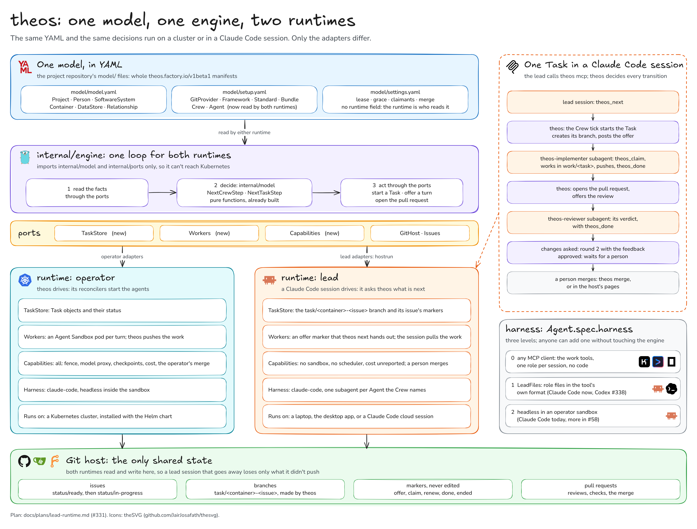

# theos in a Claude Code session: the lead runtime

GitHub issue #331, written 2026-11-24 in the owner's session. The plan, not
the build: each step below is an issue.

## Goal

A person opens Claude Code in a project repository, on a laptop or as a
cloud session on the web. The session then works the project's issues the
way a Crew does on the cluster:
- the same model YAML, its `Crew` and `Agent` objects included;
- the same decision functions (`model.NextCrewStep`, `model.NextTaskStep`);
- the same branches, markers and labels on the Git host.

The session is the lead. theos says what is next, each role is a Claude
Code subagent, and a person merges.

[](../images/lead-runtime.svg)

The board's source is [images/lead-runtime.excalidraw](../images/lead-runtime.excalidraw).
Its icons are from theSVG (github.com/JairJosafath/thesvg).

Other harnesses (Codex, Kimi Code, OpenCode, Gemini CLI) are kept in the
shape of every interface here, but only Claude Code is built. Any MCP
client gets the work tools with no adapter.

## Read this first

- **This changes [no-cluster.md](no-cluster.md) for Claude Code.** It
  replaces that plan's decisions 4 to 8 with one engine that both runtimes
  call, and it reads Crews and Agents from the model where that plan kept
  them cluster-only. Decisions 1 to 3 and 9 to 12, the loss table and steps
  1, 4 and 7 to 11 stand. The table under
  [What this changes](#what-this-changes) lists each change.
- **It takes up [external-agents.md](external-agents.md)'s markers.** Both
  runtimes use one grammar: `offer`, `claim`, `renew`, `release`, `done`,
  `blocked`, `nothing`, `ended`. In the lead runtime theos posts the
  `offer` and the `ended`, as the operator does for an outside agent.
- **A person merges** (`PersonMerges`). By default every session holds the
  person's own credential (`AgentHoldsOwnerCredential`), as no-cluster's
  decision 9 says.
- No step needs Kind or `make e2e`.

## Decisions, and why

Code is cited as it is on main at 633ffc0.

1. **Two axes with two names: runtime and harness.**

   | Axis | The question it answers | Values |
   | --- | --- | --- |
   | Runtime | who drives the loop | `operator`: theos's reconcilers start the agents (Kubernetes); `lead`: an agent session calls theos, wherever it runs |
   | Harness | which agent tool does a role's work | `Agent.spec.harness`: `claude-code` here; `stand-in` in tests |

   A laptop session, a desktop session and a Claude Code cloud session are
   all the `lead` runtime, so the runtime is named by who drives, not by
   where it runs. It is not `session`, because `Session` is a kind.
   "Target" is not used either: `DeployTarget` is a kind.

   The runtime is not a field in the manifests. It is whatever reads them:
   the operator reads the API server, the `theos` binary reads `model/`. So
   a model moves between runtimes unchanged, and a Container repository
   still holds nothing that says which runtime made it.
2. **One engine, `internal/engine`, which imports `internal/model` and
   `internal/ports` only.** A tick does three things:
   - reads the facts through ports;
   - calls the decision function;
   - carries out the step through ports.

   The operator calls a tick from each reconcile. The lead runtime calls it
   from each `theos` command (`next`, `claim`, `done`, `status`). Both
   check the current state and move it one step, so a lead session that
   dies loses nothing: the next command starts from the host.

   Why: the decision functions are already pure (`NextCrewStep`,
   `internal/model/crew.go:276`; `NextTaskStep`, `task.go:1315`). What can
   drift between two runtimes is the code around them, which builds the
   facts and acts on the step. no-cluster's `internal/nocluster` would be a
   second copy of that code; the engine is the only copy.
   `internal/modelfacts` already does this for the scaffold.
3. **Two new ports, `TaskStore` and `Workers`, and a `Runtime` that
   bundles them with what it can do.**

   ```go
   // TaskStore keeps a Container's Tasks and their progress.
   type TaskStore interface {
       Tasks(ctx context.Context, container string) ([]model.CrewTask, error)
       Start(ctx context.Context, container string, s model.IssueStart) error // idempotent
       Progress(ctx context.Context, task string) (model.TaskProgress, error)
       SaveProgress(ctx context.Context, task string, p model.TaskProgress) error
   }

   // Workers runs one role's turn on a Task.
   type Workers interface {
       Offer(ctx context.Context, w model.WorkOrder) error
       Run(ctx context.Context, task string, round int, role string) (model.RunState, error)
       End(ctx context.Context, task string, round int, role, why string) error
   }

   type Runtime interface {
       Store() TaskStore
       Workers() Workers
       Capabilities() Capabilities
   }
   ```

   | Port | Operator adapter (`internal/controller`) | Lead adapter (`internal/adapters/hostrun`) |
   | --- | --- | --- |
   | `TaskStore` | Task objects and their status | the branch `task/<container>-<issue>` and its issue's markers |
   | `Workers.Offer` | make the Sandbox (theos pushes the work) | post an `offer` marker; `theos next` hands it out (the session pulls the work) |
   | `Workers.Run` | the Sandbox's pod as a `model.RunState` | the markers as a `model.RunState` (#307) |
   | `Capabilities` | everything | decision 6's table |

   The engine never knows whether the work was pushed or pulled. An
   operator-only behaviour (suspend, resume, pause) is an interface a
   `Workers` has or hasn't, as `internal/agentrunner` already does for a
   harness (`harness.go`, "the runner asks for the interface, never for
   the harness").
4. **The Git host is the lead runtime's only store.**
   - Progress (the round, the phase, the round's feedback) is read back
     from markers.
   - Worktrees live under the project repository's `work/`, which git
     ignores, and can be thrown away at any time.
   - Nothing lives in the session's home directory.

   Why: a Claude Code cloud session's container goes away, and a laptop
   session can be closed. With the state on the host, a new session picks
   up where the last one stopped.
5. **theos makes the lock, not the session.** The engine's Crew tick
   starts a Task. Its `TaskStore.Start` creates the branch (`CreateBranch`
   fails on a branch that exists, `internal/ports/githost.go:403-405`),
   labels the issue `status/in-progress` and posts the `offer`. A session
   only claims an offer; it never creates a branch.
   - A `task/` branch with no offer and no pull request is the engine's own
     start that stopped halfway, and the next tick posts the offer.
   - So no-cluster's third case (`LockWithoutClaim`, a lock a person
     clears) goes. The `task/` prefix is theos's; a person's branch doesn't
     use it.
   - Two lead sessions on one Crew are safe: the host lets one branch
     creation through. They may run one Task over `parallel` between a list
     and a create, and the guide says to run one lead per project.
6. **Crews and Agents are read in the lead runtime, from
   `model/setup.yaml`.** Each field is either honoured or named with a
   reason word by `theos status`. Nothing is dropped silently.

   | Field | Lead runtime | Reason word |
   | --- | --- | --- |
   | Crew `implementer`, `reviewer`, `routes`, `parallel`, `paused`; Agent `maxRounds` | honoured | |
   | Agent `model` | honoured: the subagent's model | |
   | Agent `harness` | `claude-code` honoured; any other value is read for its MCP tools only | `HarnessNotBuilt` |
   | Crew `triager`, `specWriter`, `specApproval`, `verifier` | honoured since step 13 (was `RoleNotBuilt`) | |
   | Crew `schedules`, `tagReleases`, `prepareReleases`, `releaseCadence`, `publishReleases` | not honoured | `NoScheduler` |
   | Crew `approval`, the operator's merge | a person merges | `PersonMerges` |
   | Crew `taskBudgetUSD`; Agent `sessionTokenLimit` | not honoured | `CostUnreported` |
   | Agent `image`, `resources`, `env`, `credentialsSecretRef`, `timeoutMinutes` | not honoured | `NoSandbox` |

   `image` stays required by the CRD. `theos init` writes the chart's
   agent image there, so the file moves to a cluster unchanged. A table
   test has a row per field of `CrewSpec` and `AgentSpec`, so a field
   added later fails the test until someone decides its row.
7. **A harness is an interface. The content is theos's; the format is the
   harness's.**
   - `internal/method` holds the content: the lead playbook, the role
     boundaries and the work order text, as pure renderings (no-cluster
     decision 5).
   - `internal/harness` defines the interface:

     ```go
     type Harness interface {
         Name() string               // the value in Agent.spec.harness
         Capabilities() Capabilities // subagents, parallel, a model per role, MCP
     }
     // Optional parts, asked for by interface, never by name.
     type LeadFiles interface{ Render(p Project) []File }
     ```

   - `internal/harness/claudecode` renders the content into the project
     repository:
     - `CLAUDE.md`: one line that imports `AGENTS.md`;
     - `AGENTS.md`: the lead playbook;
     - `.claude/agents/theos-<agent>.md`: one file for each Agent a Crew
       names, with the Agent's `model` and the role's tools. The reviewer
       gets no `Agent`, `Edit` or `Write` tool: its verdict is its own;
     - `.mcp.json`: starts `theos mcp` over stdio.

     Each file is marked as generated, and `theos status` reports one that
     drifted.
   - These files go in the project repository. A Container repository's
     `CLAUDE.md`, `.claude/` and `.mcp.json` are its Standard's protected
     paths, and theos doesn't touch them there.
   - Three levels, for the other harnesses later (step 14):
     - 0: any MCP client gets the work tools, one role per session, with
       no code;
     - 1: `LeadFiles`;
     - 2: headless in an operator sandbox, today's `agentrunner.Harness`
       (#58).
8. **The loop in a Claude Code session.**

   ```
   lead (main session, in the project repository)
     theos_next  ──► engine: Crew tick, then a Task tick for each Task
                 ◄── open offers, up to parallel, each naming its subagent
     spawns theos-<implementer> with the work order, in the background for parallel
       subagent: theos_claim  (claim marker; theos makes work/<task>, a worktree of the Container)
                 works, runs the Container's own checks (its AGENTS.md), pushes
                 theos_done   (done marker: the commit and a summary)
     theos_next  ──► engine: run done ⇒ OpenPR (theos opens it) ⇒ StartReview ⇒ offer
     spawns theos-<reviewer>  ──► theos_done with its verdict
     theos_next  ──► changes requested ⇒ round 2 with the feedback
                 ──► approved ⇒ Merge, which here means waiting for a person
   person: theos merge, or the host's pages ──► next tick: the Task is done, the issue closes
   ```

   theos opens the pull request and decides every transition; the lead
   only spawns the subagents and passes the work orders through. Any
   `theos` call renews a claim with under half its lease left, and the work
   order tells a role to call `theos_heartbeat` after half an hour without
   one (no-cluster decision 8's lease, unchanged).
9. **A Claude Code cloud session is the same runtime. theos assumes
   nothing about the machine.**
   - The credential comes from `THEOS_GIT_TOKEN`, set as the environment's
     secret, or else from `git credential fill`. theos never stores it.
   - The binary comes from the release (#318), or from `go install` at a
     tag in the environment's setup script.
   - The project repository and every Container repository must be added
     to the session.
   - The work order says to push after each green check: work that isn't
     pushed dies with the container. A session that dies runs out its
     lease, the engine posts `ended`, and the Task is offered again on its
     branch (`AfterInterruption`, `task.go:320`).
10. **The engine posts the `offer` and `ended` markers in both runtimes.**
    In the lead runtime theos and the sessions share one account by
    default. So a marker counts by its kind and by the `claimants` setting
    (no-cluster decision 8), and the session's name in the marker tells
    the sessions apart. The session's name is its own word
    (`ReviewNotEnforced`, unchanged).
11. **The operator moves onto the engine one piece at a time, and envtest
    is the safety net.**
    - The Crew tick moves first (step 1). It is small and already
      separates its decision.
    - Then the host side of a Task: its pull request, checks, verdict and
      merge (step 5).
    - The run side, the Sandbox, moves last (step 12). It is a protected
      path and the largest piece.

    Every envtest spec passes unchanged at each step. Releases, schedules,
    deploys and Briefs stay in the reconcilers until a second runtime needs
    them: abstract what two runtimes use, not everything.
12. **What can be configured is configured.**
    - The host, its owner and the registries are the GitProvider's fields.
    - The roles, models and parallelism are the Crew's and the Agents'.
    - The lease, the grace, `claimants`, `merge` and the project
      repository's name stay in `model/settings.yaml` (no-cluster decision
      12).
    - The lead runtime adds no setting of its own.

## What this changes

| In [no-cluster.md](no-cluster.md) | Now |
| --- | --- |
| Decision 4: `internal/nocluster` holds the commands' logic | it holds the commands; the loop is `internal/engine`'s, and the lead runtime's adapter is `internal/adapters/hostrun` |
| Decision 5: one fixed method bundle | `internal/method`'s content, rendered by a harness; which Agent plays which role, on which model, is the Crew's |
| Decision 6: runtimes are Claude Code, `AGENTS.md` readers, MCP clients | those are harnesses (decision 1 here); Claude Code is built, the rest are level 0 |
| Decision 7: `theos next` hands out one work order | it returns the engine's open offers, up to the Crew's `parallel` |
| Decision 8: a session claims by creating the branch; `LockWithoutClaim` | the engine creates the branch and posts the offer; a session claims an offer; the lock a person cleared is gone |
| "Cluster-only": Crews | Crews are read in both runtimes; schedules, releases and budgets stay cluster-only |

## Steps

Priority 1 is the first wave. Work them in the order below: each one names
what it needs. "Tier" is AGENTS.md's.

| Step | Issue | Priority | Needs | Tests it brings |
| --- | --- | --- | --- | --- |
| 1. The engine and its ports: the Crew tick, the operator's `TaskStore` | #332 | 1 | | tier 4: the Crew's envtest specs unchanged; tier 1: the engine on the fake store and host; `contract.TaskStore`; `TestImports` |
| 2. Claims and the lease in `internal/model` | #267 | 1 | | tier 1: a row per sentence of decision 8's lease, with decision 5's change |
| 3. The run markers as a `RunState` | #307 | 1 | 2 | tier 1: a row per marker; another account's marker changes nothing; a quoted marker is none |
| 4. Crew and Agent in the model files; capabilities | #333 | 1 | | tier 1: a row per field of decision 6; tier 2: a sample setup file |
| 5. The engine's Task tick, host side shared | #334 | 1 | 1, 3 | tier 4: the Task's envtest specs unchanged; tier 1: one Task to a pull request waiting for a person |
| 6. The lead runtime on the Git host, `hostrun` | #335 | 1 | 1, 3, 5 | tier 1: the contracts on the fake and `githubtest`; the whole Task end to end; tier 3 on Gitea |
| 7. The harness interface and Claude Code's files, `theos agents` | #266 | 1 | 4 | tier 1: the files for a Crew; the reviewer's tools; every work order names `AGENTS.md` and `theos heartbeat` |
| 8. `theos mcp`: the work tools | #294 | 1 | 6, 7 | tier 1: an in-process client over stdio; no merge tool; issue text fenced, no credential |
| 9. A person merges, `theos merge` | #292 | 1 | 5 | tier 1: the merge table; refused away from a terminal |
| 10. Release the `theos` binary | #318 | 1 | | the release itself; the owner's session (`.github/`) |
| 11. The guide: Claude Code on a laptop and on the web | #297 | 1 | 6 to 10 | `make doc-links`; a person's walk of one Task in each |
| 12. The operator's Task reconciler on the engine | #336 | 2 | 5 | tier 4 unchanged; `contract.Workers` on the Sandbox adapter |
| 13. Triager, spec writer and verifier in the lead runtime | #337 | 2 | 6 to 8 | tier 1 on the fake host; tier 4 triage unchanged |
| — `theos plan` | #293 | 2 | 6 | its issue's |
| — `theos update`, `export`, `import` | #295 | 2 | 4 | its issue's |
| 14. Harness authoring: `harnesstest`, the guide, Codex | #338 | 3 | 7 | tier 1: the suite on both harnesses |

**Step 1 as built** (`internal/engine/crew.go`, `internal/ports/runtime.go`,
`internal/controller/crew_tasks.go`). Choices the plan left open:
- `CrewTick` returns a `CrewResult`: the step, and the hand-backs that
  failed, by issue. The engine logs nothing; the runtime logs them. A
  failure to read the host is an `*engine.HostError`, so the operator still
  waits on `GitHostUnavailable` while any other error is the store's.
- `CrewInput.Before` runs between the read and the decision, with the facts
  the decision takes. The operator's releases, schedules and onboarding run
  there, as they ran there before. It doesn't run while the Container isn't
  Ready, and the host may then be nil.
- `TaskStore` has `Tasks` and `Start` alone; `Progress` and `SaveProgress`
  come with #334, the first step that calls them. `Tasks` leaves out Triage
  Tasks, which the Crew reads apart.
- `Workers` and `model.WorkOrder` are declared, unused. The operator's
  `Workers()` is nil until #336, as is the fake's until #334.
- `Capabilities` has a field per reason word of decision 6 but
  `HarnessNotBuilt`, which is a harness's: `Merges`, `Sandboxes`,
  `Schedules`, `Costs` and `AllRoles`. The operator has all five.
- The reconciler still lists the Tasks itself, for releases, triage and the
  Paused condition; the store lists them again, live. That is one more
  list a reconcile, and the store's is at least as new as the decision
  needs. The proposed issues a triager reads are read by the reconciler,
  before the tick.
- `contract.TaskStore` runs on the fake and on the operator's adapter over
  controller-runtime's fake client, in `make test`.

**Step 2 as built** (`internal/model/claim.go`). Choices the plan left
open:
- A marker line is `<!-- theos:<kind> key=value ... -->`, keys sorted,
  each value one word, so it reads back as written; #307's kinds take the
  same form. A session's marker names it as `session=<name>`.
- A counted `offer` starts the work afresh: a claim before it, or before a
  later round's offer, counts for nothing.
- A holder is its account and its session's name together, so two
  claimant accounts with one session name are two holders.
- `lease`, `grace` and `claimants` reach `model/settings.yaml` with #294,
  the first step that reads them: the settings decode refuses a key no step
  reads. Until then `DefaultClaimRules` is the only source.

**Step 3 as built** (`internal/model/run_markers.go`). Choices the plan
left open:
- `RunFromMarkers` fills the `RunState` the Task's decision already takes,
  with no pod and no checkpoint. What only a run on the host has goes in
  `RunState.Markers`: the offer, the claim, `Unclaimed`, `EndDue` and
  `DoneWaits`.
- The engine's clock only says that an `ended` is due (`EndDue`:
  `silent` past the lease and the grace, `released` after a release). Only
  a counted `ended` makes the run interrupted. So the run's next offer
  always comes after a stamp the host gave, and an `ended` that came too
  early never lets a new offer wipe a live claim.
- `ClaimRules.Engine` holds the accounts whose `offer` and `ended` count:
  the operator's login for an outside agent. It is empty in the lead
  runtime, where they count from `claimants` by their kind.
- A `done` counts from the holder alone, and the last one counts. An
  implementer's names `commit=`: the full head, or a prefix of at least
  7 characters. A reviewer's names `verdict=`. A triager's decision is the
  one fenced json block of its text, read strictly into `Triage`. A
  takeover needs its own `done`.
- `blocked` and `nothing` close the run with their note. A `blocked`
  with no reason still blocks.

**Step 4 as built** (`internal/model/runtime_fields.go`,
`internal/nocluster`). Choices the plan left open:
- `Capabilities` is `internal/model`'s, as `model.NotHonoured` reads it,
  and `ports.Capabilities` is the same type. `OperatorCapabilities` has
  all of it, `LeadCapabilities` none but `claude-code` among the
  harnesses.
- A field counts as set when its document wrote it, before the CRD's
  defaults: `Model.Written` keeps those, so a defaulted `timeoutMinutes`
  is no `NoSandbox` line, while a written one is. A field written as
  `null` counts as left out. The harness is read whether written or
  defaulted.
- `pauseRuns` is `NoSandbox`: it pauses runs in their sandboxes.
  `specApproval` is `RoleNotBuilt`, with the spec writer. The PersonMerges
  line is the Crew's own, whatever fields it sets.
- A field the table has no row for is `UnknownField`, never dropped;
  `TestEveryFieldHasARow333` fails on a new field of `CrewSpec` or
  `AgentSpec` until it has a row.
- `theos init` writes the Agents `implementer` and `reviewer` from the
  chart's values (description, model, maxRounds) at its agent image, the
  tag the chart's, else Chart.yaml's appVersion, else the release's
  version. It can't write the Crew: a new model has no Container, and a
  Crew must name one. It writes the Crew as a comment to uncomment, and
  `theos status` says, of each Container no Crew works, to add one.
- The sample is `config/samples/webshop/crew.yaml`, kept out of the
  webshop's kustomization: on a cluster the chart makes the Agents.

**Step 5 as built** (`internal/engine/task.go`, `internal/engine/task_host.go`).
Choices the plan left open:
- `TaskStore` keeps a `ports.TaskRecord`: the `model.TaskProgress`, the
  pull request and its URL, the round's summary, when the phase last
  changed, and the reason and message a Task ended with. A pull request
  is no part of `TaskProgress`, which the operator's transitions change.
- `model.WorkOrder` carries what #334 lists: Task, issue, branch, round,
  role, Agent, feedback and lease, and the `Text` #266 renders.
- The host halves both runtimes call are `ReadChecks` (with the CI runs,
  the rerun's state and who cancelled a run; the operator passes the
  runner pods' fate as a function), `ReadPull` with `PullWanted`,
  `ReadBase` and `UpdateBranch`. The Task reconciler's `checkFacts`,
  `pullFacts`, `baseFacts` and `updateBranch` call them, and the
  reconciler's own copies went. `approvalFacts` stays: it reads the
  review's Sandbox, the run side.
- The host actions of `task_actions.go` that write the operator's status
  as they go (open, merge, approve, comment) stay until #336, which moves
  the reconciler onto `TaskTick`. `TaskTick` has its own: it opens the
  pull request, merges where the runtime `Merges`, closes the issue and
  hands a failed one back.
- Capabilities turn steps: a `Merge` in a runtime that merges nothing
  waits with `PersonMerges`, and the tick after a person merged ends the
  Task Merged and closes its issue. A step the engine has no way to carry
  out (a sandbox suspended or resumed in place, a Standard change, a
  spec, a verification) waits with `NotBuilt`.
- A run whose claim ran out (`MarkerRun.EndDue`) is ended by the tick
  that sees it, read back interrupted, and decided on in the same tick:
  `Rerun` offers it again on its branch. A rerun, a retried review and a
  conflict to resolve offer their turn in the same tick, since a turn of
  the same round offered again starts afresh, and the round's earlier
  answers count until it is.
- A request for changes goes on the pull request as a review, or, when
  the host refuses one (an account's own pull request, as where theos
  and the sessions share one), as a comment with the verdict.
- Every Task envtest spec passes unchanged; the Task tick's tests are
  tier 1 on `fake.Tasks`, `fake.Workers` and the fake host.

**Step 6 as built** (`internal/adapters/hostrun`, `internal/ports/comments.go`).
Choices the plan left open:
- The ports gain `ports.IssueComments`, an optional part of `Issues`
  asked for by interface: an issue's comments with the host's IDs,
  authors and stamps, and a comment posted and read back as stamped.
  `CommentIssue` stays as it is for its thirty callers. Gitea lists an
  issue's comments whole; GitHub pages them, and the adapter reads every
  page.
- A Task's progress is a `progress` marker the engine posts at each
  transition, `<!-- theos:progress task=<task> -->`, its `TaskRecord`
  a fenced json block read strictly; the last counted one is the Task's.
  Comments are never edited, so a Task's history is on its issue. A
  session can't post one (`SessionMarker` refuses it), and no run reads
  it.
- `Start` creates the branch at main's head, labels the issue
  `status/in-progress` and posts the first progress, Pending. A branch
  there already is the Task's own, from a start that stopped halfway or a
  lead that raced this one, and the start goes on from it. The offer is
  the Task tick's first step, so a start that stopped before it is
  finished by the next tick, as decision 5 wants, with no step of
  `Start`'s own.
- `Tasks` lists the Tasks at work: the issues labelled
  `status/in-progress`. A Task that ended is not listed: its issue is
  closed, or handed back to a person. `contract.TaskStore` takes that:
  an ended Task is listed final or not at all. The lead runtime starts
  no Spec Task (`NoSpecs`).
- `Workers.Run` is `model.RunFromMarkers` on the issue's comments and the
  branch's head, for the turn the counted offer names, else not started.
  `Offer` posts nothing while the turn is offered and not answered or
  ended. `End` posts `ended` only for a turn still open: a done one needs
  none, the next offer starting afresh.
- A Runtime is one Container's; a Task's issue is read from its name
  (`model.IssueTaskName`).
- Not here yet: `lease`, `grace` and `claimants` in `model/settings.yaml`,
  and `cmd/theos`'s wiring. Both come with `theos mcp` (#294), the first
  command that runs a tick: the settings decode refuses a key no step
  reads, and `hostrun.New` takes its `model.ClaimRules` from the caller.

**Step 7 as built** (`internal/method`, `internal/harness`, `theos agents`).
Choices the plan left open, after reading Claude Code's subagent and MCP
documentation (code.claude.com/docs/en/sub-agents, .../mcp, .../memory):
- A subagent's `model` is the Agent's `model` as written: Claude Code
  takes a full model ID there as well as an alias. Its `tools` are a
  comma-separated list; `mcp__theos__*` gives it every tool of
  `theos mcp`. The implementer has `Read, Grep, Glob, Edit, Write, Bash`,
  the reviewer `Read, Grep, Glob, Bash`: no `Agent`, `Edit` or `Write`.
  Neither has `Agent`, so neither starts another subagent.
- The generated marker is an HTML comment in the Markdown files and a YAML
  comment in a subagent's frontmatter. `.mcp.json` is JSON, which takes
  no comment, and carries none; `theos status` compares every file with
  what `theos agents` writes now, so a hand edit of it is named too.
- An Agent two Crews give two roles is refused: its one subagent file
  can't have both roles' tools.
- `issueBlock` and its intro moved to `internal/model` (`IssueBlock`,
  `IssueIntro`), which `internal/agentrunner` and `method.WorkOrder` call.
  The planner's plan format is not in the playbook yet: `theos plan`
  (#293) is the first step that hands one out.
- The engine renders no text: `TaskInput.OrderText` is the runtime's
  rendering of an offer (`method.WorkOrder`, which #294 passes), and
  `model.WorkOrder.Goal` carries the issue for it to fence.
- `theos agents` writes only a file that differs and says of each whether
  it was written or unchanged; a model with no Crew is refused. `theos
  status` names a file that is missing or changed, when the model has a
  Crew.

**Step 8 as built** (`cmd/theos/lead.go`, `internal/nocluster/lead.go`).
Choices the plan left open:
- The MCP SDK is github.com/modelcontextprotocol/go-sdk v1.8.0: `go list
  -deps` shows it brings neither client-go nor controller-runtime, and
  `cmd/theos`'s `TestImports` keeps it so. It is linked by `cmd/theos`
  alone; the tools' work is `internal/nocluster`'s, on the ports and the
  engine, and `cmd/theos` builds `hostrun` for it (`Env.Runtime`), as it
  builds the host adapters.
- Six tools: `theos_next`, `theos_claim`, `theos_heartbeat`,
  `theos_release`, `theos_done` and `theos_status`, each reading the model
  files afresh. Each is also a command, printing its result as JSON:
  `theos next`, `claim`, `heartbeat`, `release` and `done`, with `-task`,
  `-session`, `-commit`, `-verdict` and `-summary`. No merge tool.
- `theos_next` runs each Crew's tick, then a Task tick for each Task at
  work, and returns the open offers (offered and unclaimed), each with its
  subagent and its work order (`method.WorkOrder`, which fences the
  issue), and a line for every Task at work with its phase and the step's
  reason, such as `PersonMerges`. The Agents of a Task are the Crew's,
  or a route's by the issue's labels, read each tick.
- A claim posts the claim, reads the issue back and holds the work only
  when the host's order names the session (`model.NextClaim`,
  `model.ClaimOf`). It then clones the Task's branch into `work/<task>`
  with git, which asks its own credential helper: theos hands git no
  credential. `work/` holds a `.gitignore` of `*`, so no clone lands in
  the project's commits. A plain clone, not a worktree: the project
  repository is not the Container's.
- `heartbeat` renews under half the lease left and says how long the
  claim holds; `release` and `done` post only for the session that holds
  the claim. `done` takes a verdict of `approve` or `changes` alone.
- `lease`, `grace` and `claimants` are `model/settings.yaml`'s keys now,
  Go durations, 60m and 5m and the credential's own login by default;
  `theos init` spells the two durations out.
- No result carries the credential, and the issue's text reaches a result
  only fenced, in a work order: the test reads every result for both.

**Step 9 as built** (`internal/model/person_merge.go`, `theos merge`).
Choices the plan left open:
- `theos merge -task <task>` holds itself, on every host, what no host
  is trusted to hold for a person: a counted approving verdict on the
  pull request's head, the checks main requires (`model.BaseState` of the
  rule's contexts on the head) and the protected paths (the pull
  request's files against the rule's). The host's merge holds what it
  holds besides, as GitHub's adapter does. The fake host's merge stays
  as the controller's specs know it.
- The verdict counts when it is a reviewer's `done` with `approve` in a
  review run offered after the implement run whose `done` named the
  head, from a holder other than that run's: a session's name tells the
  sessions apart where they share one account (decision 10). A verdict
  of an earlier round is `VerdictOnAnOlderHead`; the author's own is
  `AuthorsOwnVerdict`; one from outside `claimants` counts for nothing,
  so `NoApprovingVerdict`.
- `merge` in `model/settings.yaml` is `person` (the default) or `rules`;
  any other is refused at decode, and `rules` is refused at the merge,
  `RulesMergeNotBuilt`, until #298.
- Away from a terminal (stdin no character device) `theos merge` is
  refused, a speed bump for an agent, not a fence; `theos mcp` has no
  merge tool. The next tick sees the merge and ends the Task Merged, its
  issue closed.
- Not run here: the merge on the fake GitHub and on Gitea. The checks and
  protected paths are theos's own on every host, and the model's table
  and the fake host's run test them; GitHub's adapter merge has its own
  tests; Gitea needs a non-root host for `make test-gitea`.

**Steps 10 and 11 as built.** The release workflow builds `theos` for
Linux and macOS, amd64 and arm64, stamped with the release's version so
`theos init` pins that release's catalog, and attaches it with the other
binaries in `SHA256SUMS` (#318); the README names the download and
`go install`. [no-cluster.md](../no-cluster.md) is the guide (#297): getting
theos and its credential, `init`, `scaffold`, `protect`, `agents`, one Task
on a laptop and in a cloud session, one lead per project, and each reason
word `theos status` prints. A person's walk of one Task in each, with the
host's pages in `docs/screenshots/`, is still to do: it settles
[Not tested, and who can](#not-tested-and-who-can), and the guide says
what it found once it is done.

**Step 12 as built (slice 1: the Workers adapter)** (`internal/controller/task_workers.go`).
#336 lands in slices, each green as its own pull request. This first one is
the operator's `Workers` and the contract run on it. The Task reconciler is
unchanged: nothing outside the tests builds these Workers yet, and every
Task envtest spec is untouched. Choices the plan left open:
- **The Workers are one Task's, for one reconcile** (`r.workers(task,
  status, build)`), as `crewRuntime` is one Crew's. They work on the status
  as the reconcile leaves it, which the reconciler writes once, at the end.
  A turn of another Task is an error.
- **A turn is a Sandbox named as the reconciler names it.** The name is
  `model.SandboxName` of the call's round and role and the status's
  restarts, review attempts and reruns (`sandboxName`). So the engine's
  restart (end the turn, save the moved counters, offer it again) makes a
  new Sandbox, as the reconciler's rerun does today.
- **Offer** makes the Sandbox with `buildSandbox`, from a `sandboxBuild`
  the caller passes: the run's inputs, `runSandbox`'s. Like `startRun`, it
  names the Sandbox in the status and forgets the old pod and
  `agentBackAt`. If the Sandbox is there already, Offer makes nothing; it
  only names it in a status that forgot it.
- **Run** is `runState` on the pod the status says the run started on,
  then `withSuspendedFor` and `withoutNothing`: `facts.Run` as the
  reconciler reads it now. It also keeps the run's first pod in the status,
  as `facts` does, so a replacement pod reads as an interrupted run.
- **End** of the current run is `endRun`: the run is counted, recorded
  and its leases taken. Its Sandbox is deleted after `writeStatus` inside
  a Reconcile (`withEndedRuns`, #922), and at once outside one. End of
  another turn deletes that Sandbox the same way. So the engine's `next`
  and `restart`, which end a turn before they save the progress, lose no
  run when the status write fails.
- **A run ended for its claim** (`silent`, `released`). A Sandbox has no
  claim, and the operator's Run never says an end is due. But the contract
  asks that such a run read interrupted until its turn is offered again,
  and an outside agent on a cluster (#260) would have a claim. So End
  marks the Sandbox `theos.factory.io/ended-run=<why>` and suspends it at
  once, and a current run is counted and recorded first. Agent Sandbox
  deletes its pod and starts no other. Run then reads it done and
  interrupted. The turn's next End deletes it. An Offer of the turn deletes
  it and makes a new one, and errs while the old one is still being
  deleted.
- **The contract's lapse** on Sandboxes is a pod evicted with no answer
  (`podDisrupted`). Run reads that as done and interrupted, which the
  contract takes.
- Tests: tier 1, `TestSandboxWorkersContract336` (`contract.Workers` on
  controller-runtime's fake client, with the UIDs an interceptor gives) and
  the adapter's own cases: `TestSandboxWorkersNameTheTurnAsTheReconciler336`,
  `TestSandboxWorkersDeleteTheSandboxAfterTheStatus336`,
  `TestSandboxWorkersKeepARunEndedForItsClaim336` and
  `TestSandboxWorkersRunTheirTaskAlone336`. Tier 4, "The operator's Workers
  keeps the Workers contract on Sandboxes": `contract.Workers` in envtest,
  as the operator's ServiceAccount under the generated role. It runs as a
  subtest of the suite's own `*testing.T` (`suiteT`), since a contract
  takes one.

What the later slices of #336 must do:
- **Slice 2, the run side on the tick.** `Reconcile` reads the Task, calls
  `engine.TaskTick` and writes the status. Its runtime's store keeps the
  status in memory (`Progress` from it, `SaveProgress` into it, the one
  write still `writeStatus`). Its Workers are `r.workers(task, status,
  build)`, with `build` from `runSandbox`'s inputs. The steps before a run
  can wait or end the Task: `runInputs` (the Agent's credentials, the
  Standard on main, a closed issue), `continueEarlierTry` and
  `startAtReview`, `leaseEnvironments` and a Benchmark's base branch. Offer
  returns only an error, so these need a place of their own: an optional
  part of `Workers` the engine asks for before it offers, or a typed wait
  that `build` returns and the tick turns into a wait. Choose one and
  record it here. The first run's comments (`announce`) and the `Running`
  condition go with it.
- **Suspend, resume and pause** become optional parts of `Workers` the
  engine asks for by interface (`ports.Suspender`, `ports.Resumer` and a
  pauser), as `agentrunner` asks for a harness's. The operator's Workers
  implement them with `suspendRun`, `resumeRun` and `syncPause`. The Task
  tick's `carry` turns those steps into `NotBuilt` waits today.
- **What the tick doesn't carry yet**: the operator's own host actions
  (open, merge, approve and comment as they write status), the Standard
  change, specs, verification, a person's approval and rules, budgets, and
  the Plan, Triage and Score Tasks' reconciles. Their roles' Sandboxes are
  named by `model.SandboxName` too, so the same Workers serve them.
- `slotHolders` counts a Sandbox marked `ended-run` as holding a slot while
  it lasts. In the engine it lasts only until the same tick's restart ends
  the turn. A slice that lets it last longer leaves it out of the count.

**Step 12 as built (slice 2: the turn's offer on the tick)** (`internal/controller/task_tick.go`,
`internal/engine/task.go`, `ports.Preparer`). `TaskReconciler.Reconcile` now
reads the Task, its Container and Agents, calls `engine.TaskTick` and writes
the status. The tick reads the record from the status, the run through the
Task's Workers, decides with `model.NextTaskStep`, and offers a turn (the
start of an implement, review or verify run) through the Workers. Every
other step is the reconciler's `apply`, called from inside the tick, as it
was. Every Task envtest spec passes unchanged. Choices the plan left open:
- **The group moved is the turn's read and offer**: the run read back
  (`Workers.Run`, which `TaskReconciler.facts` now takes from the tick
  instead of reading the Sandbox itself) and the three start actions
  (`Workers.Prepare`, then the engine's save of `model.StartRun`, then
  `Workers.Offer`). The turn's **end and restart did not move**: the
  engine's `restart` (Rerun, RetryReview, ResolveConflicts) ends the run,
  saves and offers the turn again in the same tick, while the operator
  ends the run, writes the status with its reason (`Interrupted`,
  `ReviewerFailed`, `ResolvingConflicts`) and offers it on the next pass,
  through the start's gates (credentials, the environments leased under the
  new Sandbox's name). Moving them would change the status between passes
  that the specs read, so they stay `apply`'s, with every other `End`.
- **Three engine extensions, each optional**, so the lead runtime and the
  fakes tick as before: `TaskInput.Facts` reads the Task's facts in place
  of the engine's reads of the host (it gets the record's facts and the
  run, as `CrewInput.Before` gets the Crew's); `TaskInput.Carry` is asked
  first for each step decided and carries out those it returns true for,
  after which the engine reads the record back from the store; and
  `ports.Preparer`, an optional part of `Workers`, readies a turn before the
  engine saves its start. The operator passes no host: with `Facts` set and
  only offers left to it, the engine needs none, and a step that needs the
  host with none is an error, never a nil call.
- **The pre-offer gates are `ports.Preparer`**, not a typed wait `build`
  returns: `build` runs inside `Offer`, after the engine saved the start,
  and a held start must save nothing, or the status would be written
  Implementing with no Sandbox. `taskTurn.prepare` is `startRun`'s first
  half (`runInputs`, `continueEarlierTry` and `startAtReview`,
  `leaseEnvironments` under the name the Sandbox will have, the branch and a
  Benchmark's base); held, the status says why and the reconcile's
  requeue is the gate's. The engine says `ReasonOfferHeld`; the reconciler
  keeps the step decided for `setPaused` and `queueForSlot`, as before.
  A ready Preparer may have changed the record (an earlier try's pull
  request and feedback taken over): the engine reads it back and saves the
  start on it, and refuses a readying that moved the round.
- **The store is the status in memory** (`statusStore`): `Progress` from it
  (`recordOf`, which the Crew's store shares), `SaveProgress` into it, a
  final phase ending the Task as `end` does. `PhaseSince` is read, never
  written: `writeStatus` stamps a phase change, as it always has. `Tasks`
  and `Start` are refused; the Crew's store has them.
- **What the offer says** is the reconciler's, after the tick
  (`taskTurn.started`): the `Running` condition, and the first run's
  comments (`announce`, `noteContinued`) only when the offer made the
  Sandbox (`sandboxWorkers.created`), never when it found it made (#906).
  An offer that finds its Sandbox made also forgets `agentBackAt`, as
  `startRun` did. `startRun` is gone; the Plan, Triage and Score reconciles
  start their runs their own way, as before.
- Tests: tier 1, `TestTaskTickHoldsAnOfferItsWorkersAreNotReadyFor336`,
  `TestTaskTickStartsOnTheRecordTheWorkersReadied336`,
  `TestTaskTickDecidesOnTheRuntimesFacts336`,
  `TestTaskTickLeavesTheRuntimeItsSteps336` and `TestTaskTickWithNoHost336`
  (the engine on the fakes); `TestStatusStoreKeepsTheReconcilesStatus336`,
  `TestSandboxWorkersPrepareAndSayWhatTheyMade336` and
  `TestTaskTurnLeavesTheEngineTheStarts336` (the operator's adapters on
  controller-runtime's fake client); slice 1's contract runs unchanged.
  Tier 4: every Task envtest spec, unchanged, runs the reconciler on the
  tick.

What the remaining slices of #336 must do:
- **Slice 3, the turn's end and restart.** Rerun, RetryReview,
  ResolveConflicts, NextRound (Retry), Verify and RetryVerify through the
  engine's `next` and `restart`, with `Workers.End`. The engine's restart
  must offer on a later tick where the Workers ready a turn (`Preparer`),
  so the start's gates run for the new Sandbox's name; and the Progressing
  reason each step writes needs a place: a reason the engine's step carries
  that the reconciler writes after the tick, as `started` does for
  `Running`.
- **Suspend, resume and pause** as optional parts of `Workers`
  (`ports.Suspender`, `ports.Resumer`, a pauser) on `suspendRun`,
  `resumeRun` and `syncPause`, which `taskTurn.carry` calls now.
- **The host actions** (open, merge, approve, comment as they write
  status), the Standard change, specs, verification, a person's approval
  and rules, budgets: each moves when the engine carries it as the
  operator does, and `Carry` hands it over. With the last, `Carry` and
  `Facts` go, and the facts are the engine's reads through the ports.
- **The Plan, Triage and Score reconciles** go on the tick last; their
  roles' Sandboxes are named by `model.SandboxName`, so the same Workers
  serve them.
- `slotHolders` still counts a Sandbox marked `ended-run`; no slice lets
  one last past its tick yet.

**Step 12 as built (slice 3: a turn's end and restart on the tick)** (`internal/controller/task_tick.go`,
`internal/engine/task.go`). The six steps that end a turn and move the Task
on are the engine's now: Verify, RetryVerify, Retry (the next round),
RetryReview, Rerun and ResolveConflicts. The engine's `next` and `restart`
end the run through `Workers.End`, which is `endRun` on the status's
Sandbox, and save the progress through the store; the reconciler says what
the end says. Every Task envtest spec passes unchanged. Choices the plan
left open:
- **A restart offers on a later tick where the Workers ready turns.** With
  `ports.Preparer`, `restart` ends the run and saves, and offers nothing:
  the status write triggers the next reconcile, which decides the turn's
  start again and readies it (credentials, the environments leased under
  the new Sandbox's name) before it offers, as the reconciler's rerun
  always did. Workers that ready turns name each turn apart (the operator's
  Sandbox names count the reruns and review attempts), so the ended run
  reads back not started. Workers that ready nothing (the lead runtime's,
  the fakes) offer in the same tick, as before, so the lead runtime's
  behaviour is unchanged (`TestTaskTickLeaseRunsOut334` still passes).
- **What the end says is the runtime's, through `TaskInput.Ending`,**
  called before the Workers end the run, in place of the engine's own
  comment (the round not accepted, the conflict to resolve). The operator's
  (`taskTurn.ending`) posts as each Agent's own account and keeps the
  verdict in the status before the review's Sandbox goes: the approval for
  the verification (`approveForVerify`), the request for changes as a
  review or the round's comment (`sayNotAccepted`), the conflict's comment
  (`sayConflicts`), and a round no agent judged drops an earlier verdict,
  as `apply` does. With `Ending` set, Retry and ResolveConflicts need no
  host; the operator still passes none.
- **The Progressing reason each step writes is the reconciler's, after the
  tick** (`taskTurn.ended`), as `started` writes `Running`: `turnEnded`
  maps the step to its reason (`Verifying`, `VerifierFailed`, `NextRound`,
  `ReviewerFailed`, `Interrupted`, `ResolvingConflicts`) and its log line,
  and `apply`'s own turn ends (RerunPaused, and the guard's fallback below)
  call the same function, so the two say it alike. The reason is the
  operator's status vocabulary, so it stays out of the engine's step.
- **The engine ends the turn only where it would end the run `endRun`
  ends** (`taskTurn.endsAsTheEngine`): the phase's turn, named from the
  status's counters, is the status's current Sandbox, or the phase has no
  run and the status names none. `endRun` ends whatever Sandbox the status
  names, and `Workers.End` ends the turn the counters name; a status that
  forgot its Sandbox (a status write that failed after an offer) or names
  another would have the two differ, so such a step stays `apply`'s.
- **The engine reads the record back after `Carry` declines a step**, as
  it does after `Facts`: bringing the run's pause up to date may write the
  status, and the step is carried out on the record as the store keeps it.
- **What stays in `apply`, and why.** RerunPaused: the engine has no such
  step (a pause that costs no rerun; it waits `NotBuilt` there), so it
  moves with the pauser. AgentUnavailable and ReviewAgain end a run too,
  but write more than a reason (`agentBackAt` and its requeue; the Standard
  change's approval ended), and the engine has neither step. Suspend,
  resume and pause did not fit: they keep the Sandbox, which `Workers.End`
  deletes, so they need the optional parts below.
- Tests: tier 1,
  `TestTaskTickRestartsOnALaterTickWhereTheWorkersReadyTurns336` (a rerun
  and a review tried again, on preparing fakes: nothing offered or readied
  in the restart's tick, the turn readied and offered on the next) and
  `TestTaskTickLeavesATurnsWordsToTheRuntime336` (Ending before the run
  ends, no engine comment, no host) in the engine;
  `TestTaskTurnLeavesTheEngineATurnsEnd336` and
  `TestTaskTurnSaysWhatATurnsEndSays336` on the operator's turn. Tier 4:
  every Task envtest spec, unchanged.

What the remaining slices of #336 must do:
- **Suspend, resume and pause** as optional parts of `Workers`
  (`ports.Suspender`, `ports.Resumer`, a pauser) on `suspendRun`,
  `resumeRun` and `syncPause`, with RerunPaused, which `apply` carries now.
- **The other ends of a run**: AgentUnavailable (the Agent's outage, its
  requeue) and ReviewAgain, once the engine has those steps.
- **The host actions** (open, merge, approve, comment as they write
  status), the Standard change, specs, verification's own steps, a
  person's approval and rules, budgets: each moves when the engine carries
  it as the operator does, and `Carry` hands it over. With the last,
  `Carry`, `Facts` and `Ending` go, and the facts are the engine's reads
  through the ports.
- **The Plan, Triage and Score reconciles** go on the tick last.
- `slotHolders` still counts a Sandbox marked `ended-run`; no slice lets
  one last past its tick yet.

**Step 12 as built (slice 4: a run kept in place on the tick)** (`internal/ports/runtime.go`,
`internal/engine/task.go`, `internal/controller/task_workers.go`, `internal/controller/task_tick.go`).
Suspend, resume and pause are optional parts of `Workers` the engine asks
for by interface, and the operator's Sandboxes implement them: the engine
suspends a run (SuspendRun, PauseRun, SuspendForAgent), resumes it
(ResumeRun) and brings its pause up to date before every step. RerunPaused
and ReviewAgain moved with them, as turn ends. Every Task envtest spec
passes unchanged. Choices the plan left open:
- **Three ports, not one pauser.** `ports.Suspender.Suspend(task, round,
  role, Suspension)` takes why (`SuspendInterrupted`, `SuspendPaused`,
  `SuspendForAgent` with when the agent is back, which the engine works
  out with `model.AgentBackAt`) and reports whether the suspend was fresh.
  `ports.Resumer.Resume(order)` may hold, as `Preparer` does, and the
  engine then waits `OfferHeld`. `ports.Pauser` has `AskPause(why)`, empty
  to take the ask back, and `HoldSuspended`, so the engine, not the
  Workers, decides which a run gets (`taskTick.pause`, as `syncPause` did:
  a working run is asked `model.PauseRequest`, a suspended one a pause
  holds is held). Workers without a part wait `NotBuilt` on its step, as
  every runtime did before; a Pauser-less runtime is asked nothing.
- **The engine counts the resume; the Workers count the run.** The
  reconciler's `suspendRun` counted the run's cost, set `countedPod` and
  counted a resume only when the run was not counted yet, so a suspend
  that failed after its status write is only suspended again. The run's
  cost and `agentBackAt` are the operator's status, so the Workers keep
  them (`suspendCurrent`, which `suspendRun` now wraps for the Plan,
  Triage and Score reconciles); the resume is the record's
  (`model.SuspendRun`), so the engine saves it, and only when `Suspend`
  says it was fresh.
- **The pause is brought up to date before `Carry`**, on every step of a
  phase with a run, where `taskTurn.carry` called `syncPause` before.
  `taskTurn.carry` no longer touches the pause; the Plan and Triage
  reconciles still call `syncPause` themselves.
- **Only the Task's current run is kept in place.** `suspendRun`,
  `resumeRun` and `syncPause` act on the Sandbox the status names; the
  Workers name a turn from the status's counters. So `Suspend` and
  `Resume` refuse a turn that is not the status's Sandbox, `AskPause` and
  `HoldSuspended` leave one as it is (as `syncPause` did), and
  `taskTurn.carry` leaves these steps to the engine only where
  `endsAsTheEngine` holds, as for a turn's end; elsewhere `apply` still
  carries them.
- **What a run kept in place says is the reconciler's, after the tick**
  (`taskTurn.keptInPlace`), as `ended` says a turn's end: a fresh suspend
  writes `Interrupted`, `Paused` or `AgentUnavailable` (with when the agent
  is back; `runSuspended`), a resume writes `Running` (`runResumed`), and
  a suspend that was not fresh or a held resume says nothing more. The
  Workers record what they did (`sandboxWorkers.suspended`, `resumed`).
  A resume is readied by `taskTurn.readyResume` (`runInputs`, the test
  environments leased again under the Sandbox's name), which `resumeRun`
  did first; held, the status says why and `result` when to look again.
- **RerunPaused and ReviewAgain are turn ends** (`engine.TurnEnd`):
  RerunPaused is a restart with `model.RerunPaused` (a restart, no rerun
  spent), offered on a later tick where the Workers ready turns, as Rerun;
  ReviewAgain ends the review's run and goes back to the checks
  (`model.ReviewAgain`), what it says on the pull request the runtime's
  (`taskTurn.ending` comments as the operator's account) or the engine's
  comment. `turnEnded` writes `ApprovalEnded` for it, so `apply`'s
  fallback and the engine's say it alike. Neither is reachable in the lead
  runtime (its runs report no pause, and an approval running out is the
  operator's fact), so its behaviour is unchanged.
- **AgentUnavailable stays in `apply`.** It ends the run and waits for
  the agent until `agentBackAt`, with a requeue then. The engine's record
  has no place for when the agent is back, and `Workers.End` deletes the
  Sandbox, so nothing would keep it; SuspendForAgent can move because the
  suspended Sandbox and the status the Workers keep hold it. It moves when
  `TaskRecord` carries when the agent is back, which a lead runtime whose
  session reports an outage would need too.
- **The contract**: `contract.SuspendingWorkers`, apart from
  `contract.Workers` so the existing envtest spec (one project per
  subtest) runs unchanged: a working turn suspended reads suspended and
  why, a repeat is not fresh, and, its worker gone (`Vacate`, which plays
  Agent Sandbox deleting the pod), it resumes as the same turn and answers
  as any. Neither the fakes nor `hostrun` keep runs in place, so it runs
  on the operator's Sandboxes alone.
- Tests: tier 1, `TestTaskTickSuspendsAndResumesARunInPlace336`,
  `TestTaskTickSuspendsAPausedRunAndOneWaitingForItsAgent336`,
  `TestTaskTickBringsARunsPauseUpToDate336`,
  `TestTaskTickWaitsWhereTheWorkersKeepNoRunInPlace336` (the lead
  runtime's behaviour kept), `TestTaskTickRerunsAPausedRunThatCantResume336`
  and `TestTaskTickReviewsAgainAnApprovalThatRanOut336` in the engine;
  `TestSandboxWorkersSuspendingContract336`,
  `TestSandboxWorkersSuspendAndResumeTheCurrentRunAlone336`,
  `TestSandboxWorkersPauseTheCurrentRunAlone336` and
  `TestTaskTurnSaysWhatARunKeptInPlaceSays336` on the operator's adapters;
  slice 3's `TestTaskTurnLeavesTheEngineATurnsEnd336` and
  `TestTaskTurnSaysWhatATurnsEndSays336` now count RerunPaused and
  ReviewAgain among the engine's turn ends. Tier 4, "keeps the suspending
  Workers contract on Sandboxes", under the generated role; every Task
  envtest spec, unchanged, among them "Paused runs" and the checkpoint
  specs, now runs these steps through the Workers.

What the remaining slices of #336 must do:
- **AgentUnavailable**, once `TaskRecord` says when the agent is back
  and the engine's wait reads it.
- **The host actions** (open, merge, approve, comment as they write
  status), the Standard change (Propose, Resume, DoneByStandardChange),
  NothingToDo, specs (AwaitApproval, SpecDeclined), verification's own
  steps, a person's approval and rules, budgets: each moves when the engine
  carries it as the operator does, and `Carry` hands it over. With the
  last, `Carry`, `Facts` and `Ending` go, and the facts are the engine's
  reads through the ports.
- **The Plan, Triage and Score reconciles** go on the tick last; they
  still suspend, resume and pause through `suspendRun`, `resumeWith` and
  `syncPause`, which the same Workers can serve once they do.
- `slotHolders` still counts a Sandbox marked `ended-run`; no slice lets
  one last past its tick yet.

**Step 12 as built (slice 5: the host actions on the tick)** (`internal/controller/task_host.go`,
`internal/controller/task_tick.go`, `internal/engine/task.go`, `ports.TaskRecord.AgentBack`).
The engine opens the round's pull request, runs its failed checks again and
fails the Task for the operator, through the operator's host, and ends a
turn whose agent is unavailable, its record keeping when the agent is back.
`Carry` no longer carries OpenPR, RerunChecks, Fail or AgentUnavailable
where the engine acts on the run the reconciler would. Every Task envtest
spec passes unchanged. Choices the plan left open:
- **The operator's host is `taskHost`**: the operator's own account on the
  Container's Git host (`gitRepo`), but for `OpenPullRequest`, which goes as
  the Container's agent bot (`agentGitRepo`), as `openPR` did: the
  implementer's pull request is its work, and the host refuses a review of
  one's own pull request, so the operator could not review it otherwise.
  Every other call the engine makes for these steps (the CI runs at the
  commit, a rerun of their failed jobs) is the operator's account's, as
  `apply`'s were. The adapter keeps `contract.GitHost`, `contract.Issues`
  and `contract.CI` on the fake (`TestTaskHostKeepsTheHostContracts336`);
  the CI suite's two JobRunners subtests skip, as the adapter is a
  `TaskHost` and the Task tick registers no runner. It can't run on Gitea
  here (`make test-gitea` needs a Gitea that runs as root); the Crew's
  envtest spec reads the pull request's author as the agent bot.
- **The host is resolved when a step needs it** (`TaskInput.Host`), not
  passed to `TaskTick`: reaching it reads the GitProvider and its Secret,
  most steps need neither, and a GitProvider or Secret that is missing must
  fail only the step that needs it, as `apply`'s did. `TaskInput.HostTimeout`
  is the operator's Git timeout, in place of the engine's minute.
- **What the pull request says is the runtime's** (`TaskInput.Pull`): its
  branch, title and description. The operator's open from `status.branch`,
  which an earlier try's pull request may have set (`continueEarlierTry`),
  and title and describe a Benchmark's, a spec's, a goal with no issue and
  a Standard change's other files as `openPR` did. After the tick the status
  says `Checking` and the reconcile looks again (`taskTurn.opened`); the
  notes (a spec's label, a later round's other files, a check that fails on
  main too, with its Event) follow the status write (`taskTurn.afterWrite`),
  so a retry after a write that failed posts none twice (#906).
  `Reconcile` now writes the status, then calls `afterWrite`.
- **The engine's `rerunChecks` is the operator's**, which changes the lead
  runtime's: a session reaches it when its agent pushes again the commit
  whose checks failed, or a job of its checks is killed for lack of memory
  (docs/no-cluster.md says what a user sees). A run at the commit still running
  waits for it (`Wait` with `Recheck`), where the engine went on with the
  step unchanged; with no failed run, a commit pushed again has its failure
  read as it stands (`Wait`, its due rerun cleared), and any other fails the
  Task, `NoCIResult`, where the engine saved a rerun of nothing; a refusal
  fails it with the operator's message. The reconciler writes the reason
  each says (`Waiting`, `Checking`, `RerunningChecks`; `taskTurn.carried`),
  as reasons are the operator's vocabulary.
- **A failure's words go through `Ending`**, which now covers
  `model.ActionFail`, the decided one and the one the engine turns a refused
  or empty rerun into. The operator's comments `The Task failed.` and drops a
  Blocked Task's proposal before the run ends (a Blocked Task has no run, so
  this is the order `fail` had); a decided failure also keeps the review's
  verdict and the step's feedback, as `apply` did, and the engine reads the
  record back after `Ending` so the feedback stays. The issue goes back to
  a person after the tick, once the Task failed (`failed`, which `fail`
  shares), as `fail` handed it back after `endRun`. A Triage Task's failure
  keeps the engine's words; its reconcile is not on the tick.
- **AgentUnavailable is a turn end**: `TaskRecord.AgentBack` is when the
  agent is due back (`model.AgentBackAt`), carried to and from
  `status.agentBackAt` by `recordOf` and `setRecord`; the engine's own facts
  read `AgentBackIn` from it, and a turn's offer forgets it, as the
  operator's Offer does. The reconciler says it after the tick
  (`waitForAgent`, which `apply`'s fallback shares) and looks again when the
  agent is due. The lead runtime's markers report no outage, so its
  behaviour is unchanged; a runtime whose done run reads back done after
  `End` would need its turn named apart, as the operator's Sandboxes and the
  fakes do. The slice 3 test row that said the record had no place for it
  flipped (`TestTaskTurnLeavesTheEngineATurnsEnd336`).
- **The same guard**: these steps are the engine's only where
  `endsAsTheEngine` holds. In Checking with the approving review's Sandbox
  kept (`mergeWhenChecksPass`), a rerun or a failure stays `apply`'s, whose
  `endRun` ends that Sandbox.
- **What stays in `apply`, and why.** **Merge**, with the approval it posts:
  a Benchmark's Task ends Approved (no final phase of the engine's), the
  merge holds for a cut release's tag (the Crew's status), a Standard
  change's gated merge may refuse or wait for CI and needs a review run that
  lasts, a merge may skip main's push run (`planSkip`, `carryChecks`), and
  the merge commit, the pull request's size, its person commits, the
  follow-ups and the by-hand issue filed from the review's run are the
  operator's status. The engine's merge has none of these. **UpdateBranch**:
  the operator keeps the review's Sandbox through the update, for the
  merge's follow-ups and the gated merge's lasting review, and starts the
  checks' wait again in the same phase; the engine ends the judging run,
  which `Workers.End` deletes. It moves with the merge. The Standard change
  (Propose, Resume, DoneByStandardChange), NothingToDo, specs (AwaitApproval,
  SpecDeclined) and the waits are unchanged.
- Tests: tier 1, `TestTaskTickRerunsTheChecksOfACommitPushedAgain336`,
  `TestTaskTickReadsAFailureWithNoRunToRunAgain336`,
  `TestTaskTickWaitsForTheRunsBeforeARerun336`,
  `TestTaskTickFailsWhereTheHostRefusesARerun336` (the engine's words and the
  runtime's), `TestTaskTickOpensThePullRequestTheRuntimeWrites336`,
  `TestTaskTickReachesTheHostOnlyForAStepThatNeedsIt336` and
  `TestTaskTickWaitsForAnUnavailableAgent336` in the engine;
  `TestTaskHostKeepsTheHostContracts336`,
  `TestTaskHostOpensThePullRequestAsTheAgent336`,
  `TestTaskTurnLeavesTheEngineTheHostSteps336`,
  `TestTaskTurnSaysWhatAHostStepSays336` and
  `TestTaskTurnSaysWhenTheAgentIsBack336` on the operator's adapters;
  `contract.TaskStore`'s progress subtest now reads `AgentBack` back and
  forgets it, on the fake, the operator's Crew store
  (`TestCrewTaskStoreContract`) and `hostrun` on both its worlds. Slice 3's
  `TestTaskTurnLeavesTheEngineATurnsEnd336` counts AgentUnavailable among
  the engine's turn ends now. Tier 4: every Task envtest spec, unchanged,
  now opens pull requests, reruns checks and fails Tasks through the engine.
  The Gitea client is unchanged; `taskHost` only routes the pull request to
  the agent bot's client, as `openPR` did, so `make test-gitea` (which needs
  a Gitea that runs as other than root) has nothing new to see.

What the remaining slices of #336 must do:
- **The merge and the branch's update**, with the approval the merge posts:
  the engine keeps the judging run until the merge where its Workers keep
  runs, and the merge's operator-only parts (a Benchmark's Approved end, the
  release hold, the gated merge, the CI skip, what a merge records and
  files) become a runtime hook or facts and record fields.
- **The Standard change** (Propose, Resume, DoneByStandardChange),
  NothingToDo, specs (AwaitApproval, SpecDeclined), verification's own
  steps, a person's approval and rules, budgets: each moves when the engine
  carries it as the operator does, and `Carry` hands it over. With the
  last, `Carry`, `Facts` and `Ending` go, and the facts are the engine's
  reads through the ports.
- **The Plan, Triage and Score reconciles** go on the tick last.
- `slotHolders` still counts a Sandbox marked `ended-run`; no slice lets
  one last past its tick yet.

**Step 13 as built** (`internal/engine/triage.go`, `internal/engine/task_roles.go`,
`internal/model/answers.go`, `internal/model/lead_roles.go`). All three
roles are built; none is left `RoleNotBuilt`. Choices the plan left open:
- **The triage tick** is `engine.TriageTick`, on `ports.TriageStore`, an
  optional part of a `TaskStore` asked for by interface: its Triage Tasks
  and a start. The operator's Crew reconciler calls it where `r.triage` was,
  its store listing the Triage Tasks live; the proposed issues are read in
  the tick, with a triager on a Container that is Ready and protected (a
  Crew on an unprotected one no longer reads them, which decided nothing).
  A decision's writes to the issue are `engine.ApplyTriageActions`, which
  the operator's Task reconciler calls too; the rest of its triage stays
  there until #336.
- **One parser.** `ParseTriage` and `ParseVerdict` moved from
  `internal/agentrunner` to `internal/model` (`answers.go`), in the
  owner's session, as #311 asks; the runner calls them. A triager's `done`
  is read by `ParseTriage`, which replaces step 3's strict reading of one
  fenced block: the last JSON object with a decision counts, fenced or
  not, and an unknown field is ignored, as the runner reads an agent. A
  reviewer's or a verifier's `done` may end with a JSON verdict in the
  runner's format, read by `ParseVerdict` for its follow-ups and open
  criteria; one whose JSON says another verdict than its `verdict=` gave
  none.
- **A Triage Task on the host** is its progress markers on its issue, the
  record marked `Triage`: no branch, no label, as the issue stays
  `status/proposed` until the decision is applied. `TriageTasks` reads the
  proposed issues' markers (`model.HostTriageTask`); one that decided, on
  an issue a person labelled `status/proposed` again, counts as answered,
  as a chat answer does on a cluster, so the issue is triaged again. A
  claim clones `main`. One whose issue a person moved out of
  `status/proposed` mid-run is no longer ticked; its open offer is
  harmless, and `PlanTriage` would skip it anyway. The lead runtime has no
  test environments, so a decision's `environments` label nothing.
- **A Spec Task** is marked `Spec` in its record, which `Tasks` reads (the
  contract's `NoSpecs` is gone). Its issue keeps `status/in-progress` until
  the spec merges, as the lead lists its Tasks by that label; the
  operator's `status/spec-review` is not used. A person's approval is a
  review by anyone but theos's own accounts (`ClaimRules.Ours`: the
  claimants and the engine's), or their merge, which is the only one where
  everything is one account. The agents' approval goes on the pull request
  as a comment: a host refuses an account's review of its own pull
  request. The spec merged, `PlanSpecMerged` writes its criteria into the
  issue, which stays open and `status/ready`.
- **The verifier** runs before the merge, as design.md's Verify says: "a
  verifier run after a merge files its follow-up" is read as what the
  round leaves being filed once a person merged. What an approving review
  and verification leave (`model.Findings`, kept by `KeepFindings` in the
  `TaskRecord`, as their runs end before the merge) is filed by the tick
  that sees the merge: the reviewer's follow-ups as proposed issues and the
  open criteria as one `kind/by-hand` issue, in `Later`, as the operator
  files them. The by-hand issue is found again by its marker; a tick that
  fails between the follow-ups and its progress may file them twice, as
  the operator's may.
- **Subagents.** The triager has `Read, Grep, Glob` and theos's tools, no
  `Bash`: it writes no file. The verifier adds `Bash`, to run the build,
  and no `Edit` or `Write`. The spec writer has the implementer's tools;
  its role is `method.RoleSpecWriter` (`spec`), as its run is the
  implementer's turn of a Spec Task (`WorkOrder.Spec`). `harness.Grants`
  gains `Shell`, and `harnesstest` checks each boundary. An Agent may be
  both the implementer and the spec writer (`method.Shares`): its one
  subagent keeps both roles' boundaries; any other pair is refused.
- **Capabilities.** The four rows are honoured by every runtime, and
  `RoleNotBuilt` and `Capabilities.AllRoles` are gone.
- Still `NotBuilt` in the lead runtime: a sandbox suspended, paused or
  resumed, and a Standard change.
- Tests: tier 1 `TestTriageToReady337`, `TestTriageSentBackByAPerson337`,
  `TestSpecApprovedThenImplemented337`, `TestSpecRefusedAndDeclined337` and
  `TestVerifierFilesItsFollowUp337` (hostrun on the fake host),
  `TestLeadTriages337` (`theos next`, `claim`, `done`), and the model's,
  method's and harnesses' rows; tier 4, the Crew's triage specs unchanged.

**Step 14 as built** (`internal/harness/harnesstest`, `internal/harness/codex`,
[harness-authoring.md](../harness-authoring.md)). Choices the plan left open:
- The harness is the lead's tool, which the person picks: `theos agents
  -harness codex`, Claude Code by default. `Agent.spec.harness` stays the
  program an operator's sandbox runs (`claude-code`, `stand-in`): a Codex
  Agent runs in no sandbox yet (level 2, #58), so the enum is unchanged.
- `harness.RoleGrants` is the part a harness has when its tool enforces
  each role's tools. Claude Code has it; Codex, whose custom agents set no
  tools and no sandbox, hasn't, and its reviewer's boundary is its
  instructions alone, which the guide says.
- `harnesstest.Check` returns the problems, `Run` reports them, so a test
  can show that a harness that drops the reviewer's boundary fails.
- `theos status` checks the files of each harness whose mark file the
  project has (`CLAUDE.md`, `.codex/config.toml`), else Claude Code's.

Steps 1, 2 and 4 need nothing and can run side by side. Step 10 can run
whenever the owner's session takes it.

**Protected paths,** the owner's session's; a Crew's agent given the step
says so and stops (AGENTS.md):
- steps 1, 6 and 7: depguard's rows for `internal/engine`,
  `internal/adapters/hostrun` and `internal/harness`, in `.golangci.yml`;
- step 10: `.github/`;
- step 12: `internal/controller/task_sandbox.go`;
- any step that adds a make target: `Makefile`.

## Not covered

- Other harnesses beyond level 0, until step 14. #58 keeps the operator's
  side of more harnesses.
- An outside agent filling a Crew spot on a cluster (#260). It uses the
  same markers and `theos` tools, and #310 becomes those tools with the
  engine running in the operator.
- `merge: rules` (no-cluster step 11, #298), GitLab (#296), Containers in
  one repository (#270).

## Done when

- A tier-1 test drives one Task through the lead runtime on the ports'
  fake. It goes from a `status/ready` issue to a pull request waiting for
  a person, then merged and closed, with the sessions played by a test
  that posts their markers (step 6).
- The operator's envtest specs pass unchanged with the Crew tick and the
  host side of the Task tick on the engine (steps 1 and 5).
- A person walks one Task in Claude Code on a laptop and one in a Claude
  Code cloud session, with the host's pages as evidence (step 11).

## Not tested, and who can

Nothing here was run against Claude Code or a cloud session.

- That a Claude Code subagent started in the background can call MCP tools
  the main session's `.mcp.json` registers, and runs its own `Bash` in a
  worktree outside its working directory. Step 11's walk shows it, and
  step 7 reads Claude Code's subagent documentation first.
- That a Claude Code cloud session may push a `task/` branch. A cloud
  session's Git access may be limited to the branches its environment
  allows. Step 11's walk on the web settles it, and if pushes are limited
  the guide says how the person allows them.
- That `api.github.com` takes `THEOS_GIT_TOKEN` from a cloud session's
  network proxy as it does on a laptop. Step 11's walk shows it.
