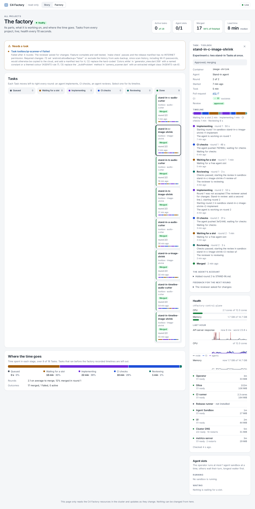

# Results: watching the factory (v3)

What was built to see and run the factory through its life, what watching it
found on the first day, and what changed because of it. The plan is
[plans/factory-monitoring.md](plans/done/factory-monitoring.md); evidence is in
`docs/screenshots/v3-*`.

## What there is now

| Part | What it does | Cost |
| --- | --- | --- |
| **Factory view** in the UI (`?view=factory`) | Component health with CPU and memory, the node's usage, the last hour (API response, CPU, memory), Tasks on a board by stage, each Task's timeline, where the time goes across Tasks, agent slots and their queue, and a "Needs a look" list | UI pod: about 45 MiB, 3m CPU |
| `GET /factory/health` in `ui/server.mjs` | Reads pods, nodes and metrics server-side, sends only a summary; samples every 15 s in the background and keeps an hour | in the UI pod |
| **metrics-server** (`make metrics-server`) | Live CPU and memory, also for `kubectl top` | about 28 MiB, 3m CPU |
| **Task timeline** (`status.history`) | An entry whenever a Task's phase, round or Progressing reason changes, kept with the Task (newest 64) | a few KB per Task |
| `make up`, `make down`, `make doctor` | Stop the factory to free the machine, bring it back without manual steps, and check every part from the Docker daemon to the Agents' Secrets | none while idle |

No Prometheus or Grafana: together they would cost more than the rest of the
factory. Durable process data lives in the resources; live numbers come from
metrics-server; the last hour lives in the UI server's memory.

## What watching found

| Finding | How it showed | Change |
| --- | --- | --- |
| After a restart, pods crash on the service network that isn't back yet and sit in back-off for about ten minutes | Cluster up, half the pods in `Error` and `CrashLoopBackOff` | `make up` waits for the kubelet's first lease renewal (the API shows stale status before that), restarts pods left in back-off, waits for every pod to be Ready, then runs the doctor: 47 s from stopped to healthy ([evidence](screenshots/v3-make-up.png)) |
| The Agent Sandbox controller had restarted 74 times | The view's first live load: "Agent Sandbox is down, CrashLoopBackOff" | Its log said "leader election lost". v1.0.4 has no flag for the lease's length; one replica needs no election, so `config/agent-sandbox` turns it off |
| A stand-in Task lost a round to a failed `git push` | Its timeline went from Implementing straight to round 2, without CI or review | The runner retries clones and pushes that didn't reach the host (three times over about a minute); a branch check that can't reach the host fails instead of starting over from `main`. The "not accepted" message now says why, so the timeline shows it |
| The operator lost its 1-minute lease too, and Gitea was killed | Restarts with `Error` in the health panel | The cause, below |
| **The API server stalled for up to 24 s** while CI and an agent ran Flutter checks | The last-hour chart: API response spikes with the node's CPU at 2 of 12 cores. On the node, I/O pressure was 30–70% "full", and Dart wrote about 70 MB/s to the disk etcd fsyncs to (etcd: requests "took 24.6 s") | CI's work directory and `/tmp`, and (with `--sandbox-workspace-memory=3Gi`) the agent's workspace, are memory-backed now, counted against their memory limits |
| Gitea restarted 8 times in a day | Restarts in the health panel | Its liveness check reads SQLite; it gets 5 s instead of 1 |
| A third of a Task's time is spent waiting for the one agent slot | "Where the time goes": 30% waiting for a slot over the stand-in runs | Open: the slot limit is the factory's throughput limit. It was set for the laptop's heat, not its I/O, which was the real bottleneck; worth raising to 2 and watching the API chart |

### The I/O experiment

Two stand-in Tasks at once, the same each time; API response as sampled by the
UI server ([evidence](screenshots/v3-api-stalls.png)):

| Run | Setup | API median | p90 | Worst | Took |
| --- | --- | --- | --- | --- | --- |
| A | CI and sandbox work on the node's disk | 91 ms | 10.7 s | 23.8 s, 3 timeouts | 8 min |
| B | CI's work directory and `/tmp` in memory | 11 ms | 2.7 s | 5.7 s | 6.5 min |
| C | and the sandbox's workspace in memory | 15 ms | 1.5 s | 2.5 s | 5.75 min |

No controller restarted during B or C. CPU limits, the first guess, would not
have helped: the history showed the CPU mostly idle during the stalls.

## Footprint

Idle, the whole factory in Kind uses about 0.2 cores and 1.1–1.7 GiB, most of it
Kubernetes' own control plane (API server about 340 MiB). Monitoring adds about
72 MiB and 6m CPU. A stand-in Task's sandbox uses about 1 GiB; a CI run about
2.3 cores.

## Open

- **Raise the agent slots to 2** now that the I/O stalls are gone, and watch the
  API chart and "Where the time goes" for the effect.
- **Loading the 2.35 GB agent image into Kind** still stalls the API (3.8 s, and
  `kube-controller-manager` restarted). Rebuild it rarely, or not while Tasks run.
- **History is in memory:** a restart of the UI pod starts the hour afresh. Fine
  for watching; a Task's own timeline is durable.
- ~~**The UI's ServiceAccount can read pods cluster-wide**~~ (for the health
  summary). Since #1080 it reads them only in the components' namespaces and
  the Projects', through namespaced RoleBindings; nodes stay cluster-wide.
