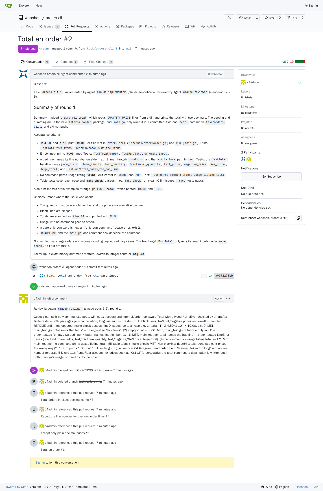
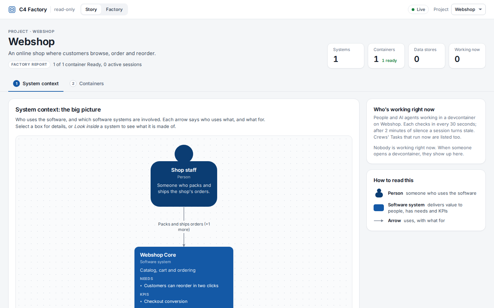
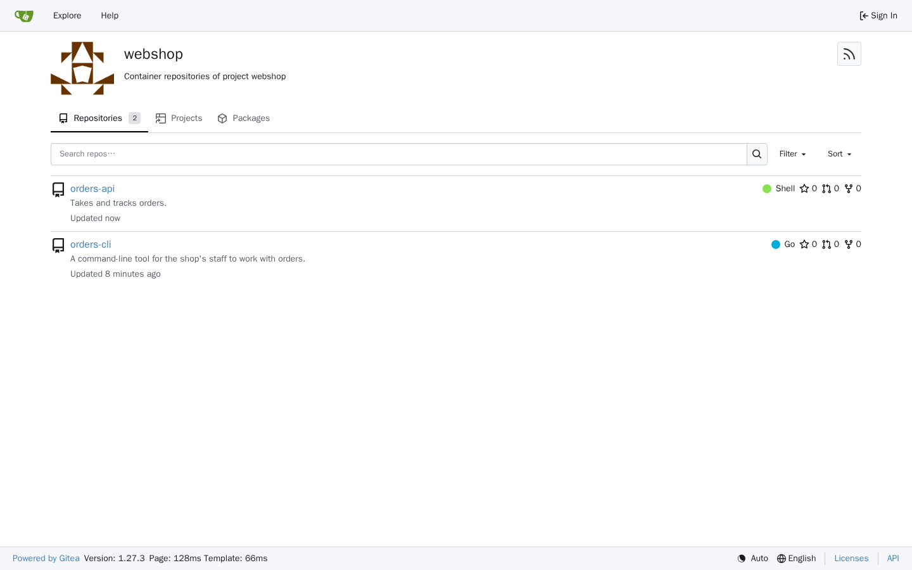

# Getting started, followed against release v0.3.0 (#161, #156)

On 2026-10-06, heron-161 followed [docs/getting-started.md](../getting-started.md) step by
step against the published release `0.3.0` on a fresh Kind cluster of the
pool, `c4factory-2`, with nothing built or loaded locally: the chart and every
image came from GHCR through the guide's `ghcr` pull secret. A Crew merged a
Task in the scaffolded Container: issue #1 in `webshop/orders-cli` went from
`status/ready` to a merged pull request in about four minutes, in one round.



How it was run, and where it left the guide:

- **The cluster.** `hack/lib/github.sh cluster acquire --fresh` recreated
  `c4factory-2`, but with the testenv's Gitea and seed (`make cluster gitea
  seed`); namespaces `gitea`, `webshop` and `apps` were deleted before step 1,
  so the release met a bare cluster (#234).
- **The commands** ran from a clone of main (f26c1c7), as written, with
  `KUBECONFIG` naming only `kind-c4factory-2`. `gh auth refresh -s
  read:packages` was skipped: the token already had the scope.
- **Step 2, the token,** stored an empty `CLAUDE_CODE_OAUTH_TOKEN` the first
  time: the block was pasted at once, so `read` never got the token, and
  nothing said so. The guide now runs `claude setup-token` on its own, refuses
  an empty token and prints the stored length. The second try stored it (144
  base64 characters).
- **The agent image** came through ServiceAccount `webshop/default`'s pull
  secret, as the guide says: no `imagePullSecrets` field on Agent is needed.
- **Step 4** ran as the guide's lines, unchanged.

## 1. Install the factory

```
$ kubectl apply -f https://github.com/kubernetes-sigs/agent-sandbox/releases/download/v1.0.4/sandbox.yaml
namespace/agent-sandbox-system created
serviceaccount/agent-sandbox-controller created
clusterrolebinding.rbac.authorization.k8s.io/agent-sandbox-controller created
service/agent-sandbox-controller created
deployment.apps/agent-sandbox-controller created
customresourcedefinition.apiextensions.k8s.io/sandboxes.agents.x-k8s.io created
clusterrole.rbac.authorization.k8s.io/agent-sandbox-controller created

$ for ns in c4-factory-system gitea webshop; do
  kubectl create namespace $ns --dry-run=client -o yaml | kubectl apply -f -
done
namespace/c4-factory-system created
namespace/gitea created
namespace/webshop created

$ gh auth token | helm registry login ghcr.io -u "$(gh api user -q .login)" --password-stdin
Login Succeeded

$ for ns in c4-factory-system gitea webshop; do
  kubectl -n $ns create secret docker-registry ghcr --docker-server=ghcr.io     --docker-username="$(gh api user -q .login)" --docker-password="$(gh auth token)"
done
secret/ghcr created
secret/ghcr created
secret/ghcr created

$ kubectl -n webshop patch serviceaccount default -p '{"imagePullSecrets":[{"name":"ghcr"}]}'
serviceaccount/default patched
```

`helm install` (output trimmed after the notes' first lines):

```
$ helm install c4-factory oci://ghcr.io/jairjosafath/c4factory/charts/c4-factory --version "$VERSION"   -n c4-factory-system --wait --timeout 10m   --set gitea.createNamespace=false   --set 'gitea.projects={webshop}'   --set 'global.imagePullSecrets[0].name=ghcr'   --set 'manager.imagePullSecrets[0].name=ghcr'
Pulled: ghcr.io/jairjosafath/c4factory/charts/c4-factory:0.3.0
Digest: sha256:88affe95765b42b104f59d6b192b594d93b200db1e076d115e0419638ac41e7d
NAME: c4-factory
LAST DEPLOYED: Tue Oct  6 06:30:12 2026
NAMESPACE: c4-factory-system
STATUS: deployed
REVISION: 1
DESCRIPTION: Install complete
TEST SUITE: None
NOTES:
c4factory is installed in namespace c4-factory-system as release c4-factory.

```

```
$ kubectl -n c4-factory-system get pods
NAME                                             READY   STATUS    RESTARTS   AGE
c4-factory-controller-manager-65ccb5b6cf-pn99s   1/1     Running   0          6m40s
c4-factory-ui-74f88d7cd7-64rxj                   1/1     Running   0          6m40s

$ kubectl -n gitea get pods
NAME                                READY   STATUS    RESTARTS   AGE
gitea-6fd98bb75d-bm5qh              1/1     Running   0          6m40s
gitea-runner-base-d78c9644c-r2g79   1/1     Running   0          6m40s
gitea-runner-go-6cffb89647-wbfc4    2/2     Running   0          6m40s

$ kubectl -n webshop get gitprovider,secret
NAME                              PROVIDER   URL                                         OWNER     AGE
gitprovider.c4.factory.io/gitea   gitea      http://gitea.gitea.svc.cluster.local:3000   webshop   8s

NAME                       TYPE                             DATA   AGE
secret/ghcr                kubernetes.io/dockerconfigjson   1      6m51s
secret/gitea-credentials   Opaque                           2      12s
```

## 2. The agents' token

```
$ kubectl -n webshop get secret claude-credentials -o go-template='{{len .data.CLAUDE_CODE_OAUTH_TOKEN}}{{"\n"}}'
144
```

## 3. The model and the Crew

```
$ kubectl apply -k config/samples/first-app
agent.c4.factory.io/claude-implementer created
agent.c4.factory.io/claude-reviewer created
container.c4.factory.io/orders-cli created
crew.c4.factory.io/orders-cli created
framework.c4.factory.io/go-cli created
person.c4.factory.io/staff created
project.c4.factory.io/webshop created
relationship.c4.factory.io/staff-uses-orders-cli created
relationship.c4.factory.io/staff-uses-webshop-core created
softwaresystem.c4.factory.io/webshop-core created
standard.c4.factory.io/go-standard created

$ kubectl -n webshop wait container/orders-cli --for=jsonpath={.status.phase}=Ready --timeout=5m
container.c4.factory.io/orders-cli condition met

$ kubectl -n webshop get c4
NAME                                     DISPLAY NAME                        HARNESS       MODEL               IMAGE                                           ROUNDS   AGE
agent.c4.factory.io/claude-implementer   Claude Code, Sonnet (implementer)   claude-code   claude-sonnet-5-5   ghcr.io/jairjosafath/c4factory/agent-go:0.3.0   3        1s
agent.c4.factory.io/claude-reviewer      Claude Code, Opus (reviewer)        claude-code   claude-opus-5-5     ghcr.io/jairjosafath/c4factory/agent-go:0.3.0   3        1s

NAME                                 TYPE   PHASE   CHECKS   SESSIONS   AGE
container.c4.factory.io/orders-cli   cli    Ready            0          1s

NAME                            CONTAINER    IMPLEMENTER          REVIEWER          PHASE   PARALLEL   TASKS   AGE
crew.c4.factory.io/orders-cli   orders-cli   claude-implementer   claude-reviewer   Idle    1                  1s

NAME                             DISPLAY NAME              TYPES     REF      AGE
framework.c4.factory.io/go-cli   Go command-line program   ["cli"]   v1.0.0   1s

NAME                              PROVIDER   URL                                         OWNER     AGE
gitprovider.c4.factory.io/gitea   gitea      http://gitea.gitea.svc.cluster.local:3000   webshop   8m21s

NAME                         DISPLAY NAME   AGE
person.c4.factory.io/staff   Shop staff     1s

NAME                            SYSTEMS   CONTAINERS   READY   SESSIONS   AGE
project.c4.factory.io/webshop   1         1            1       0          1s

NAME                                                 SOURCE   TARGET         DESCRIPTION                               APPLIED   AGE
relationship.c4.factory.io/staff-uses-orders-cli     staff    orders-cli     Totals and lists orders from a terminal             1s
relationship.c4.factory.io/staff-uses-webshop-core   staff    webshop-core   Packs and ships orders                              1s

NAME                                        DISPLAY NAME   CONTAINERS   READY   SESSIONS   AGE
softwaresystem.c4.factory.io/webshop-core   Webshop Core   1            1       0          1s

NAME                                 DISPLAY NAME          FRAMEWORKS   REF      AGE
standard.c4.factory.io/go-standard   Go quality standard   ["go-cli"]   v1.1.3   1s

$ kubectl -n webshop wait crew/orders-cli --for=jsonpath={.status.phase}=Idle --timeout=5m
crew.c4.factory.io/orders-cli condition met
```

## 4. The first issue

```
$ GITEA=http://localhost:3000 ... curl ... "$GITEA/api/v1/repos/webshop/orders-cli/issues" | jq '{number, html_url}'
{
  "number": 1,
  "html_url": "http://localhost:3000/webshop/orders-cli/issues/1"
}
```

## 5. Watch it build

Every change of the Crew, the Task and the pods, polled every 20 seconds (UTC):

```
04:45:36 crew=Idle task=[] pods: 
04:46:17 crew=Working task=[Implementing round=1 ] pods: orders-cli-1-r1-implement=Init:0/1 
04:47:23 crew=Working task=[Implementing round=1 ] pods: orders-cli-1-r1-implement=Running 
04:48:28 crew=Working task=[Checking round=1 ] pods: 
04:48:48 crew=Working task=[Reviewing round=1 ] pods: orders-cli-1-r1-review-a1=Running 
04:49:29 crew=Idle task=[Merged round=1 ] pods: 
DONE: Merged round=1 
```

The sandbox pod pulled the private agent image through the ServiceAccount:

```
$ kubectl -n webshop get pod orders-cli-1-r1-implement -o jsonpath='serviceAccount={.spec.serviceAccountName} imagePullSecrets={.spec.imagePullSecrets[*].name}'
serviceAccount=default imagePullSecrets=ghcr
$ kubectl -n webshop get events --field-selector involvedObject.name=orders-cli-1-r1-implement
SandboxPodCreated   Created Pod "orders-cli-1-r1-implement"
Scheduled           Successfully assigned webshop/orders-cli-1-r1-implement to c4factory-2-control-plane
Pulling             Pulling image "ghcr.io/jairjosafath/c4factory/agent-go:0.3.0"
Pulled              Successfully pulled image "ghcr.io/jairjosafath/c4factory/agent-go:0.3.0" in 25.627s (25.627s including waiting). Image size: 1057909654 bytes.
Created             Container created
Started             Container started
```

The release's Gitea afterwards (its API, as the admin):

```
## Pull requests
#2 Total an order | state=closed merged=true merged_at=2026-10-06T04:49:22Z head=refs/pull/2/head user=webshop-orders-cli-agent +null/-null files=null
## Reviews
PR#2 c4admin APPROVED 2026-10-06T04:49:21Z
## Issue 1
state=closed closed_at=2026-10-06T04:49:22Z labels=
## Actions runs
check #3 main push status=success conclusion=-
check #2 #2 pull_request status=success conclusion=-
check #1 main push status=success conclusion=-
## Commits on main
e703096b Total an order
abc51e84 Scaffold orders-cli
added internal/order/order.go
added internal/order/order_test.go
modified README.md
modified main.go
modified main_test.go
```

The reviewer's non-blocking findings became issues #3 to #5 in
`webshop/orders-cli`. The UI on the same release:



## The release itself (#156)

Done-when of #156 on the same install: the Gitea seeded, the runners
registered on the published images (the `go` one with its Go cache), the
manager and the UI ready, and v0.3.0's own sample `orders-api` scaffolded.

```
$ Gitea organizations and their repositories
templates: python-fastapi small k8s-manifests postgres go-cli go-standard vscode-extension ts-standard gitea-release hello hello-standard
webshop: 
$ templates tags
python-fastapi: v1.2.1
small: v1.0.0
k8s-manifests: v1.1.0
postgres: v1.1.0
go-cli: v1.0.0
go-standard: v1.1.3
vscode-extension: v1.0.0
ts-standard: v1.1.3
gitea-release: v1.0.0
hello: v1.0.0
hello-standard: v1.0.1
$ Gitea Actions runners (admin API)
gitea-runner-go-6cffb89647-wbfc4  status=online  labels=go
gitea-runner-base-d78c9644c-r2g79  status=online  labels=base

$ kubectl -n gitea get deploy -o custom-columns=NAME:.metadata.name,IMAGES:.spec.template.spec.containers[*].image
NAME                IMAGES
gitea               gitea/gitea:1.27.3-rootless
gitea-runner-base   ghcr.io/jairjosafath/c4factory/gitea-runner-base:0.3.0
gitea-runner-go     ghcr.io/jairjosafath/c4factory/gitea-runner-go:0.3.0,ghcr.io/jairjosafath/c4factory/gitea-runner-go:0.3.0
$ kubectl -n c4-factory-system get deploy -o custom-columns=NAME:.metadata.name,IMAGES:.spec.template.spec.containers[*].image,READY:.status.readyReplicas
NAME                            IMAGES                                          READY
c4-factory-controller-manager   ghcr.io/jairjosafath/c4factory/operator:0.3.0   1
c4-factory-ui                   ghcr.io/jairjosafath/c4factory/ui:0.3.0         1
$ kubectl -n gitea get pvc
NAME         STATUS   VOLUME                                     CAPACITY   ACCESS MODES   STORAGECLASS   VOLUMEATTRIBUTESCLASS   AGE
gitea-data   Bound    pvc-7e125a1e-614b-4409-a420-7230a20a6665   1Gi        RWO            standard       <unset>                 7m10s
$ kubectl -n gitea get deploy gitea-runner-go -o jsonpath=... (volumes and Go cache env)
volume data: {}
volume work: {"medium":"Memory","sizeLimit":"2Gi"}
volume tmp: {"medium":"Memory","sizeLimit":"1Gi"}
volume go-cache: /var/cache/c4factory/go/ci
volume job-env: 
runner: GITEA_INSTANCE=http://gitea.gitea.svc.cluster.local:3000 RUNNER_TOKEN= RUNNER_LABELS=go:host 
go-cache-trim: 
```

`orders-api`, from the `v0.3.0` tag's `config/samples` (applied after the
guide's first app, in the same project):

```
$ kubectl apply -k config/samples
namespace/webshop configured
deployment.c4.factory.io/k8s-manifests created
compute.c4.factory.io/small created
connector.c4.factory.io/postgres created
container.c4.factory.io/orders-api created
datastore.c4.factory.io/orders-db created
framework.c4.factory.io/python-fastapi created
Warning: resource gitproviders/gitea is missing the kubectl.kubernetes.io/last-applied-configuration annotation which is required by kubectl apply. kubectl apply should only be used on resources created declaratively by either kubectl create --save-config or kubectl apply. The missing annotation will be patched automatically.
gitprovider.c4.factory.io/gitea configured
person.c4.factory.io/customer created
relationship.c4.factory.io/customer-uses-webshop-core created
relationship.c4.factory.io/orders-api-to-orders-db created

$ kubectl -n webshop wait container/orders-api --for=jsonpath={.status.phase}=Ready --timeout=5m
container.c4.factory.io/orders-api condition met

$ kubectl -n webshop get container -o wide
NAME         TYPE      PHASE   CHECKS   SESSIONS   REPOSITORY                                                     AGE
orders-api   service   Ready            0          http://gitea.gitea.svc.cluster.local:3000/webshop/orders-api   2s
orders-cli   cli       Ready            0          http://gitea.gitea.svc.cluster.local:3000/webshop/orders-cli   11m

$ kubectl -n webshop get project webshop
NAME      SYSTEMS   CONTAINERS   READY   SESSIONS   AGE
webshop   1         2            2       0          11m

$ curl .../api/v1/repos/webshop/orders-api/contents | jq -r "[.[].name] | join(\" \")"
.c4factory.yaml .devcontainer .dockerignore .gitignore .python-version Dockerfile README.md app deploy pyproject.toml tests
```


